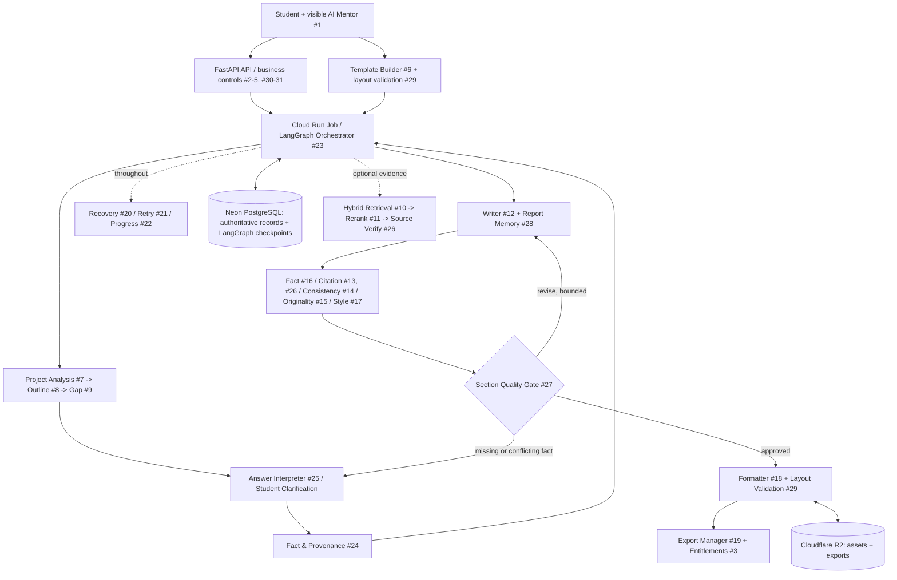

# Acadence — Multi-Agent & Service Responsibility Architecture v1.1

**Status:** Agreed design baseline; not yet implemented or integration-tested.  
**Previous version:** v1.0 (31 logical responsibilities), preserved in full below.  
**Companion docs:** `ACADENCE_TECH_STACK_V2_2.md` and `ACADENCE_SYSTEM_ARCHITECTURE_V1_1.md`.

> **Read-first precedence:** This v1.1 section is authoritative on the new **36-role inventory**, **nine independently deployed microservices**, new visual pipeline and cross-service communication. All previously recorded **31 roles are preserved with the same IDs and responsibilities**. The complete historical v1.0 reference is included verbatim later; where it says “31” or describes a single API deployment, use this v1.1 update instead. Do **not** instantiate 36 permanent LLM bots or 36 independent microservices.

## 1. Architecture decision summary

- Keep the **one visible voice-and-text AI Mentor (#1)**; the user does not need to interact with 35 independent agents.
- Keep **LangGraph (#23)** as the controlled coordinator of AI steps and human-interrupt workflows, not as an arbitrary cross-service message bus.
- Keep **Neon PostgreSQL** as durable state, with **service-owned schemas** and strict write permissions; LangGraph PostgreSQL checkpoints for resumption; Cloudflare R2 for images, document assets and reports.
- Use **nine independent Cloud Run Service deployments**, with AI/document/visual Cloud Run Jobs when required. Frontend remains Next.js on Cloudflare Workers.
- Separate **business decisions** (verified identity, entitlement and payments) from **AI reasoning**; LLMs cannot grant plans, create invoices, alter confirmed facts, or approve a fake reference.
- Incorporate **student-uploaded images** before or during questioning, **factual Mermaid diagrams**, **clearly illustrative AI-generated images**, and **charts backed by real datasets**.
- No project-specific inventions: software technologies, algorithms, clinical data, research results, components, diagrams, screenshots and experimental measurements must have student-confirmed provenance.
- Strict quality gates, idempotency, bounded revisions, cross-section memory, offline recovery, and plan-based DOCX/PDF/LaTeX entitlements remain unchanged.

## 2. Five new roles #32–#36 (added; none of #1–#31 removed)

| ID | Final name | Category | Deployable service ownership | Contract and responsibility |
|---:|---|---|---|---|
| **32** | **Diagram Generation Agent** | **AI** | AI Orchestration calls Visual AI | Produce *structured* diagram intention/spec (type, nodes, edges, labels, directions, supporting confirmed fact IDs, intended section). No unsupported project details. Request clarification if topology or flow is unknown. |
| **33** | **Diagram Validation & Rendering** | **SERVICE** | Visual AI | Validate diagram schema and facts, compile safe Mermaid syntax, render SVG and compatible raster output, detect broken/unsafe markup and poor readability, return versioned asset refs. Prefer Mermaid JS + vetted server renderer. |
| **34** | **Image Understanding Agent** | **AI** | Visual AI; Project manages factual confirmation | Analyze an uploaded screenshot, diagram, photo or template sample using a vision-capable model. Extract *candidate observations*, source locations/confidence and unanswered questions. No claim becomes a confirmed project fact without relevant student confirmation. |
| **35** | **AI Image Generation Agent** | **AI** | Visual AI | Plan and request optional conceptual illustrations through a vetted diffusion/image model API (FLUX.2 candidate). Store provider/model/prompt version, label images as AI-generated illustrations, prevent fabricated experiment evidence or fake implementation screenshots. |
| **36** | **Visual Asset & Figure Manager** | **SERVICE** | Visual AI owns asset metadata; Document owns final placement | Register/upload/approve/version/render assets, record origin, rights, content hash, dimensions, alt text, captions, figure numbering requests, target section and private R2 refs; distinguish evidence/uploads from illustrations. |

**Updated audited counts:** AI = **10** (#1, #7, #8, #9, #12, #17, #25, #32, #34, #35); HYBRID = **9** (#6, #13, #14, #15, #16, #24, #26, #27, #28); SERVICES = **17** (#2, #3, #4, #5, #10, #11, #18, #19, #20, #21, #22, #23, #29, #30, #31, #33, #36). **Total = 36**. Categories describe logical work; e.g. AI Image Generation includes a managed external generation provider, not an LLM pretending to draw pixels itself.

## 3. All 36 responsibilities mapped to one owning service

| ID(s) | Owning microservice | Responsibility mapping and boundary |
|---|---|---|
| **#2** | **Auth** | Session Guard; verified identities, token lifecycle, device-risk controls, authenticated requests; all services still authorize resource ownership. |
| **#3, #4, business-quotas half of #30** | **Billing** | Subscription, payment and **authoritative quota ledger**. Only Billing authorizes entitlement reservations/settlement. |
| **#24** | **Project** | Fact/provenance ledger; structured intake, confirmed answers, upload-to-fact confirmations and contradiction handling. |
| **#6** | **Template** | Initial-page builder/defaults, three-template maximum, page-block versions and chosen project snapshot. |
| **#1 AI role logic; #7, #8, #9, #12, #17, #20, #21, #22, #23, #25, #28, job half of #30, #32 initiation** | **AI Orchestration** | LangGraph control, Mentor dialogue output, project understanding, outline, gap questions, writer, style editor, memory, workflow state, job lifecycle, retries, recovery and progress. #32 requests executable diagram work from Visual AI. |
| **#10, #11, #13, #14, #15, #16, #26, #27** | **Quality** | Conditional retrieval/reranking/source checks plus citation, consistency, originality, fact verification and section approval; citations require evidence, not invented references. |
| **#33, #34, #35, #36** | **Visual AI** | Diagram rendering, image understanding, illustrative generation and asset registry. Work for #32 runs here after request via AI Orchestration; confirmations commit through Project. |
| **#18, #19, #29** | **Document** | Canonical model, preview support, page layout, format-specific rendering, DOCX/PDF/LaTeX, export authorizations (checked against Billing), layout QA. |
| **#5** | **Notification** | OTP delivery task, payment notices, report completion and recovery notices; identity confirmation stays with Auth. |
| **#31 (cross-cutting)** | **Every service + gateway** | Policy enforcement is distributed to every trust boundary; no unrestricted “all-access” policy agent exists. |

**Ownership conflicts resolved:** #30 is a logical coordinator with two non-overlapping record owners: Billing owns monetary/project entitlements and reservations; AI Orchestration owns report job lifecycle, linked via opaque reservation ID and idempotent API/event transitions. #1 voice UI presentation is in frontend, while controlled AI Mentor decisions remain in AI Orchestration. #24 is authoritative for confirmed facts: a model's “candidate facts” stored by Visual AI never bypass Project confirmation.

## 4. Inter-agent message and cross-service communication protocol

**Do not implement unstructured agent-to-agent chat.** Use typed request/response contracts and durable events with IDs and versions.

| Pattern | Typical call | Safety requirement |
|---|---|---|
| Synchronous bounded HTTP | AI Orchestration → Project read confirmed fact snapshot; AI Orchestration → Quality validate draft; Template/Project lookups | GCP IAM service-to-service identity (where available), explicit timeout, scope/tenant checks, typed DTOs, correlation ID, no blind retries for writes. |
| Async one-target dispatch | AI orchestration → Visual AI rendering; Document → export worker; Notification dispatch | Cloud Tasks **candidate** for per-target queue; idempotency and bounded retries; dead-letter/reconciliation strategy. Do not require both Tasks and Pub/Sub without a need. |
| Async event fanout | `report.section.approved`, `asset.approved`, `export.completed` when several consumers subscribe | Pub/Sub **conditional** for fanout; use transactional outbox/consumer deduplication where events and DB must remain consistent. |
| Long-running execution | Orchestrator → Cloud Run Job | Persist `job_id`, `run_id`, `checkpoint_id`, `input_version`, ownership, prompt/model versions, task idempotency and allowed concurrency. |
| Streaming to browser | Progress Service → SSE → Cloudflare Workers frontend | Events are persisted and sequenced; reconnect from last ID, polling fallback; never synthesize completion before durable commit. |

### Typed envelopes

**All tasks:** `{task_id, request_id, project_id, report_id?, job_id?, actor_id, role_id, source_version, template_snapshot_id?, fact_snapshot_version?, idempotency_key, trace_id, created_at, requested_action, payload_ref}`. Every service checks the caller's scope and its own authorization.

**DiagramSpec (example):** `{diagram_id, project_id, section_id, kind, nodes:[{id,label,fact_refs}], edges:[{from,to,label?,fact_refs}], layout, provenance_refs, status}`. Validate graph properties and factual source refs before Mermaid rendering.

**ImageObservation (example):** `{asset_id, project_id, source_image_version, observations:[{text, location?, certainty, proposed_fact_id?}], clarification_questions, student_confirmed:false}`. Do not set `student_confirmed` based on vision confidence alone.

**VisualAsset (example):** `{asset_id, owner_id, project_id, origin:'student_uploaded'|'ai_generated'|'verified_external'|'derived_chart'|'mermaid_diagram', source_asset_ids, approved, rights_status, caption, alt_text, r2_key, content_hash, dimensions, intended_section_id, version, is_actual_project_evidence}`. `is_actual_project_evidence=true` requires independently established provenance, not an LLM guess.

**QualityVerdict:** `{draft_id, fact_snapshot_version, citation_state, originality_state, visual_state, decision:'approved'|'revise'|'needs_student_input'|'blocked', issues:[...], reviewer_version}`. Optional illustration failure may be non-blocking; missing *required* figures block approval.

## 5. Visual-agent coordination workflows

### A. Student uploads a screenshot or actual prototype photo

`Student → Project upload intent/auth → private R2 object → Visual AI (#34) candidate observations → Project #24 proposed facts → Mentor #1 asks student to confirm/correct → Project confirmed fact version → Gap #9 and Outline #8 re-evaluate affected needs → Writer #12 uses confirmed facts → QA #16 checks claims → Document #18 inserts approved original image if allowed.`

Uploads may also serve as university formatting samples or report figure assets; they must be tagged accordingly. A format sample does *not* imply an official/university-certified template.

### B. Report chapter needs a flowchart / system architecture diagram

`Writer #12 requests a figure → Diagram Agent #32 assembles DiagramSpec from *confirmed* project facts → if facts missing, Gap #9 → Mentor #1 confirmation → Visual AI #33 compiles/renders Mermaid safely → Visual Asset #36 records version/caption/source → QA #16/#27 accept or return for revision → Document #18/#29 preview and export.`

Mermaid diagram types are chosen by actual need: flowchart, system architecture, ER, sequence, state, class, etc. A diagram is never invented merely to fill pages. SVG is vector-preferred where supported; PNG fallback can be used for particular exporters.

### C. Conceptual illustration requested

`Approved image intent → #35 chooses provider/model with cost/policy guard → image-generation API returns output → #36 stores image labeled `AI-generated conceptual illustration` → relevant student approval + Quality check → Document placement.`

A generated picture **must not** be presented as an actual screenshot, research outcome, clinical scan, photographed participant, system implementation, or data result. Sensitive uploads are not forwarded to outside providers without appropriate privacy basis.

### D. Numeric chart

`Verified student data → Visual AI deterministic chart function (Matplotlib/Plotly) → #36 provenance/units → #27 visual data check → Document.` No invented values or untraceable numeric results.

## 6. Fault isolation, retries and completion guarantees

| Failure | Expected behavior |
|---|---|
| Voice service unavailable | Mentor continues with typed dialogue. Saved answers preserved. |
| Visual diffusion provider unavailable | Optional illustrations pending/omitted with transparent notice; core text generation continues. |
| Required Mermaid diagram cannot be rendered | Do not silently ship blank figure; preserve draft, repair safely or request clarification; block approval if required by report/spec. |
| Student-uploaded image unreadable | Request re-upload; do not hallucinate image content; existing project knowledge remains. |
| Quality or plagiarism provider unavailable | Keep drafts; mark checks `pending`/`unverified`; do not falsely mark checks passed or grant full approval when mandatory. |
| Document export worker unavailable | Keep approved report and template snapshot; retry export only, do not regenerate AI content or double-charge project quota. |
| Billing service temporarily unavailable | Fail closed for new entitlement grants; keep prior verified state/reconciliation; never invent payment success. |
| Auth service unavailable | Never bypass authorization; allow only operations supported by still-valid independently validated credentials and established policy. |
| Cloud Run AI worker interruption | Resume from checkpoints/section versions, skip already-approved idempotent work. Do not keep a waiting-for-student Cloud Run Job running. |
| Web client disconnect | Cloud Run processing continues when valid; UI reconnects to persisted SSE/event status. |

**Bounded failure policy:** explicitly classify transient/permanent errors; retries with provider `Retry-After`, backoff/jitter, maximum attempts, timeout and idempotency; circuit breakers; dead letters where broker supports; no infinite revision loops. Isolation is *limited* by shared Neon, R2, GCP region and network unless these are separately replicated.

## 7. Additional acceptance and traceability checklist

- [ ] Each role ID **1–36** has a unique primary responsibility, owner, inputs, outputs, permissions and acceptance test. No missing IDs; no extra unlabeled autonomous role.
- [ ] Nine services have independent build, deploy, rollback, IAM identities, ownership/schema and health diagnostics.
- [ ] A diagram never introduces an unconfirmed technology/component or misleading system relationship.
- [ ] AI-generated images are labeled/approved as illustrative and retain model, prompt, provenance and costs.
- [ ] Uploaded images are securely validated, isolated, versioned and never auto-promoted to canonical project facts.
- [ ] Mermaid syntax, SVG output and any rich labels are hardened against untrusted content and XSS.
- [ ] Uploaded figures, generated diagrams, conceptual images and verified data charts maintain distinct types throughout preview, DOCX, PDF and LaTeX rendering.
- [ ] Citation and originality checks remain separate, with source-backed citation records and honest similarity limitations.
- [ ] All preserved v1.0 requirements remain testable: strict identity policy with web-device limitation, Hobby/Pro/Premium, three custom initial-page templates, discipline-specific questions, confirmed facts, quality gates, mentor voice, SSE, secure exports and durable recovery.

**Official technical references:** [Cloud Run IAM service-to-service authentication](https://docs.cloud.google.com/run/docs/authenticating/service-to-service), [Mermaid usage and securityLevel](https://mermaid.js.org/config/usage), [Cloudflare AI FLUX.2 listing](https://developers.cloudflare.com/ai/models/black-forest-labs/flux-2-pro-preview/).

---

## Preserved v1.0 baseline — original content unchanged

> All of the original 31 responsibilities and the detailed previous checklists remain below. Use the v1.1 update above for totals, deployment boundaries, visual stages and any direct conflict with an older diagram or role count.

# Acadence — Multi-Agent Architecture v1.0

**Status:** FINALIZED DESIGN BASELINE (implementation not yet built or integration-tested)  
**Decision date:** 2026-11-11  
**Project:** Acadence (formerly AI Report Studio / AI Project Report)  
**Companion specification:** `ACADENCE_TECH_STACK_V2_1.md`  
**Use:** Reference for ChatGPT discussions, Cursor project rules, architecture reviews, implementation tasks, and acceptance tests.

> **Non-negotiable:** Preserve all approved product requirements and selected technologies. This document defines **31 responsibilities**: **7 LLM-based AI agents**, **9 hybrid AI/validation components**, and **15 deterministic services/controllers**. It does **not** prescribe 31 independent chatbots, LLM calls, microservices, or processes. One visible AI Mentor communicates with students; backstage components collaborate through typed contracts, controlled workflow transitions, and a single durable source of truth.

## 1. Governing decisions

1. **Frontend:** Next.js App Router + TypeScript + Tailwind CSS + shadcn/ui, deployed on **Cloudflare Workers**, never silently swapped to Pages; Next.js 16/vinext pending compatibility testing.
2. **Backend:** FastAPI + Python + Pydantic + SQLAlchemy/Alembic on **Google Cloud Run Service**; **Google Cloud Run Jobs** perform long report-generation workloads.
3. **Workflow coordination:** **LangGraph** is the single AI workflow orchestrator; use selective LangChain integrations and LangSmith for tracing/evaluations. Graph execution, durable job bookkeeping, and business operations have distinct responsibilities.
4. **Shared storage:** **Neon PostgreSQL** is the authoritative store of users, project facts, answers, sections, plans, template snapshots, usage, and progress. **PostgreSQL-backed LangGraph checkpoints** persist execution state. Cloudflare R2 holds media/artifacts; Upstash Redis is an optional cache/rate-limit store, not the authoritative job record.
5. **Content source:** The report text is **primarily LLM-generated** based on **confirmed student project facts** and appropriate general explanation. Research/RAG is **conditional** for factual evidence, verifiable citations, and user-supplied materials, not the default content source.
6. **Absolute accuracy constraint:** Agents must **never fabricate project-specific technologies, architecture, methods, hardware, participants, tests, metrics, or results**. Missing or contradictory details result in clarification, explicit uncertainty, or omission.
7. **Template first:** Before adaptive project questions, student can select/create an approved report template. The **separate Template Builder tab** provides default university-style layouts and **at most three saved personal templates for preliminary/initial pages** per student. Individual page blocks are editable, insertable, reorderable, duplicable, and deletable. Selected template version is snapshotted for the project; its preliminary pages are combined with approved content on final assembly; the layout guides live preview throughout generation.
8. **Plan enforcement:** Hobby = one report up to **10 pages, preview-only**; Pro = **one** complete project up to **100 pages**, DOCX/PDF export; Premium = **two** complete projects, **100 pages each**, DOCX/PDF/LaTeX export. Entitlements are enforced on the backend, including signed downloads. Unsubscribed users see pricing after trial use. Renewal period and other commercial details remain unresolved—do not assume them.
9. **User-facing experience:** One animated, speaking/listening AI Mentor; relevant adaptive questions, typed and spoken answers stored; real-time stage explanations; live formatted preview of drafted/approved content; meaningful progress; graceful reconnection/retry/recovery.
10. **Quality:** Internal cross-chapter memory, factual consistency, claim/source checking where relevant, duplication/originality screening, natural academic prose, bounded revision loops, post-style factual recheck, document layout checks. Never promise zero plagiarism, perfect human authorship detection evasion, or perfectly identical rendering across all export formats.
11. **Security:** Authentication/authorization, payment verification, subscription activation, quota updates, device policies, and export permissions are **deterministic server-side operations**, never delegated to free-form LLM judgment. Browser-only device fingerprinting cannot guarantee one user per physical device; apply layered controls with privacy, recovery, and appeal pathways.
12. **Decision control:** Do not silently remove, merge away, rename away, or replace an approved responsibility. Internal implementation may consolidate code modules if each responsibility remains documented and tested. Proposed changes must include rationale and an architecture version update.

## 2. Complete inventory — all 31 responsibilities

**Category legend:** `AI` = LLM-guided reasoning/generation; `HYBRID` = LLM judgment plus validation or deterministic algorithms; `SERVICE` = ordinary backend/application service (no discretionary LLM authority). **Conditional** means only invoked when the report needs retrieval/references.

### A. User experience layer

| ID | Name | Category | Single responsibility / boundary |
|---:|---|---|---|
| **1** | **AI Mentor** | AI | Sole visible robot assistant. Displays/speaks relevant questions, listens/records typed or spoken answers, explains the active verified stage and next steps. Does not invent task statuses or directly approve facts, purchases, quotas or exports. |

### B. Platform and business layer

| ID | Name | Category | Single responsibility / boundary |
|---:|---|---|---|
| **2** | **Session Guard** | SERVICE | Google OIDC/mobile OTP identity, normalized unique email/phone records, session/JWT/refresh-token validation, protected routes/APIs, device/abuse signals, revocation and recovery. |
| **3** | **Subscription Service** | SERVICE | Active-plan lookup, Hobby/Pro/Premium entitlements, page/project limits, expiry, pricing redirect, paid features. No guessed payment status. |
| **4** | **Payment Service** | SERVICE | Gateway transactions, verified webhook signatures, idempotent payment events, subscription activation/cancellation/refunds according to approved commercial policies. |
| **5** | **Notification Service** | SERVICE | OTP delivery workflow, payment and account events, report-ready notifications, user-friendly failure/recovery notices. Never sends unverified completion messages. |

### C. Template intelligence layer

| ID | Name | Category | Single responsibility / boundary |
|---:|---|---|---|
| **6** | **Template Architect** | HYBRID | Separate drag/drop template builder orchestration: university-style defaults, ≤3 saved personal preliminary-page templates, editable page blocks, placeholders, template selection, immutable per-project snapshots; optional AI-assisted suggestions, never free-form overwrites of approved layouts. |

### D. Project intelligence layer

| ID | Name | Category | Single responsibility / boundary |
|---:|---|---|---|
| **7** | **Project Analysis** | AI | Interpret student qualification, discipline, specialization, title, description, known technologies/methods and actual project constraints; produce structured project blueprint. |
| **8** | **Outline Planner** | AI | Create adaptable discipline-specific chapters/subsections, objectives, topic boundaries and length/page budgets (actual page count verified after rendering). |
| **9** | **Gap Analysis** | AI | Compare section-specific information requirements against already confirmed facts; produce only missing relevant question intents, prioritize and avoid repeats. |

### E. Knowledge and retrieval layer

| ID | Name | Category | Single responsibility / boundary |
|---:|---|---|---|
| **10** | **Hybrid Retrieval** | SERVICE — conditional | Approved keyword, pgvector and metadata-filtered searches; multi-query retrieval when useful for references, uploaded documents or evidence. |
| **11** | **Reranker** | SERVICE — conditional | Rank authorized retrieved evidence for relevance; never pronounce information true just because relevance is high. |

### F. Content generation layer

| ID | Name | Category | Single responsibility / boundary |
|---:|---|---|---|
| **12** | **Chapter Writer** | AI | Draft chapters using confirmed fact IDs, outline, approved source references when relevant, section-specific goals, and global memory. Must not assert undocumented project implementation or results. |
| **13** | **Citation Agent** | HYBRID | Map claims to actual supporting evidence; validate bibliographic identifiers and source passage linkage; format citations (e.g. APA/IEEE as requested). Never invent sources, URLs or DOI values. |

### G. Quality assurance layer

| ID | Name | Category | Single responsibility / boundary |
|---:|---|---|---|
| **14** | **Consistency Reviewer** | HYBRID | Check cross-chapter contradictions, unnecessary repetition, terminology, section boundaries, and structural completeness. |
| **15** | **Plagiarism Review** | HYBRID | Check internal exact/semantic duplication and external similarity only with a properly licensed comparison provider; request targeted revision, retain citations and proper attribution. No guarantee of zero plagiarism. |
| **16** | **Fact Validation** | HYBRID | Compare implementation/results/clinical-study/project-specific claims to confirmed facts and, where needed, trusted evidence; report missing, contradicted or unsupported claims. |
| **17** | **AI Content Humanizer / Style Editor** | AI | Improve clarity, readability, varied phrasing and natural academic tone. Must not change confirmed facts, numbers, sources, methods, technical claims or citations; post-edit facts checked again. |

### H. Document layer

| ID | Name | Category | Single responsibility / boundary |
|---:|---|---|---|
| **18** | **Document Formatter** | SERVICE | Render one canonical structured document into live formatted preview and supported DOCX/PDF/LaTeX representations, preserving chosen template to the extent supported; compose approved preliminary pages and chapters. |
| **19** | **Export Manager** | SERVICE | Generate/store/version exports on R2, check owner/plan/format authorization at request time, issue short-lived download URLs after successful validation. Hobby cannot export. |

### I. Reliability layer

| ID | Name | Category | Single responsibility / boundary |
|---:|---|---|---|
| **20** | **Recovery Service** | SERVICE | Detect interrupted/stale jobs and resume safely from durable job records and graph checkpoints without overwriting approved work. |
| **21** | **Retry Service** | SERVICE | Classify retryable failures, enforce capped retries/backoff/jitter/provider `Retry-After`, rate limits and concurrency; do not retry permanent/payment/security failures blindly. |
| **22** | **Progress Service** | SERVICE | Publish real, persisted status/section events via SSE; reconnect with last event cursor and polling fallback; never fabricate percentages or statuses. |

### J. Added coordination, fact and safety layer

| ID | Name | Category | Single responsibility / boundary |
|---:|---|---|---|
| **23** | **Workflow Orchestrator** | SERVICE / LangGraph controller | Defines allowed stage transitions, task dependencies, human-in-the-loop pause/resume, approved writes, bounded revision loops, and execution trace IDs. No free-for-all agent chats. |
| **24** | **Project Fact & Provenance Manager** | HYBRID | Canonical fact ledger: values, source/answer references, confirmation state, timestamps, version/conflict resolution. Only reviewed updates become authoritative. |
| **25** | **Answer Interpreter & Clarifier** | AI | Convert student typed/voice answers into candidate structured facts; detect ambiguity/conflicts and request clarification before confirmation. |
| **26** | **Research Source Verifier** | HYBRID — conditional | Verify source existence, metadata, access and evidence relevance for cited claims; may use Crossref/OpenAlex/other discipline-specific authoritative records. |
| **27** | **Section Quality Gate** | HYBRID | Apply explicit content acceptance criteria; output `approved`, `revise`, `needs_user_input`, or `blocked`; enforce bounded revisions and post-edit validation. |
| **28** | **Global Report Memory Manager** | HYBRID | Persist short per-section summaries, covered concepts, terminology and cross-section coverage to avoid repetition while limiting token use. |
| **29** | **Layout Validation Engine** | SERVICE | Check document schema, page-block integrity, margins, placeholders, page count, TOC, numbering, overflow, export consistency, university-layout constraints. |
| **30** | **Job & Quota Coordinator** | SERVICE | Idempotent project/job creation, transactional entitlement reservation, quota settlement, duplicate-click/concurrent-request protection, state reconciliations after failures. |
| **31** | **Safety & Policy Guard** | SERVICE + optional checks | Enforce least privilege, project/tenant isolation, permitted tool actions, upload validation, prompt-injection defenses, sensitive data protections, policy checks and audit trails. |

**Audit:** IDs **1–22** reproduce every original user responsibility; IDs **23–31** are the nine agreed additions. Counts: AI **7** (1, 7, 8, 9, 12, 17, 25); HYBRID **9** (6, 13, 14, 15, 16, 24, 26, 27, 28); SERVICE **15** (2, 3, 4, 5, 10, 11, 18, 19, 20, 21, 22, 23, 29, 30, 31).

## 3. Coordination model — NOT 31 agents freely messaging one another



The diagram is a conceptual flow, not a promise that auth/payment are LLM graph nodes. **FastAPI services own business operations**, while **LangGraph owns the stateful AI tasks**. The UI never trusts a model-generated claim that a payment is valid or an export is permitted.

### State and storage ownership

| Information | Source of truth | Other uses |
|---|---|---|
| User, verified email/phone, sessions, device risk | PostgreSQL + verified identity provider records | API authorizes access |
| Plans, payments, entitlements, quota ledger | PostgreSQL + verified payment-provider events | Gate all project creation and exports |
| Saved templates, page blocks, selected immutable template version | PostgreSQL; R2 for logos/signatures | Renderer and exporters read same snapshot |
| Student answers, project facts, provenance, conflicts | PostgreSQL fact/answer tables | Read-only versioned snapshots used by agents |
| Outline, chapter objectives, section summaries | PostgreSQL | LangGraph passes IDs/compact state, not 100 pages of context |
| Current graph stage and resume context | LangGraph PostgreSQL checkpoints | Recovery uses durable job state too |
| Job attempts, section versions, quality outcomes, progress events | PostgreSQL | SSE/progress/QA and idempotent recovery |
| Source records, evidence, validated citation links (when used) | PostgreSQL/R2 | No invented bibliography |
| Final preview assets and DOCX/PDF/LaTeX exports | R2 + PostgreSQL metadata | Download only after entitlement check |
| Temporary cache / throttling | Upstash Redis, as needed | Not sole durable record |

### Communication and write rules

1. Each task receives a `project_id`, `job_id`, `task_id`, `input_version`, required fact IDs, and a Pydantic-validated task-specific payload.
2. Every AI output must parse into a **versioned structured schema**. Invalid outputs are not silently written into approved records.
3. Agents **propose** facts; only the Fact & Provenance Manager (with validation/confirmation as required) commits canonical project facts.
4. Only the Orchestrator controls graph transitions. Agents cannot bypass quality gates or launch unrelated business operations.
5. Use optimistic concurrency or version checks to reject stale writes when a student corrects an answer or changes templates.
6. Changes to a confirmed fact create a new version and mark dependent chapter drafts/quality results **stale** for revalidation or targeted regeneration.
7. Context sent to LLMs should be minimal: relevant facts, section requirements, approved summaries, allowed evidence and explicit prohibitions. Do not resend entire raw history or all 100 pages.
8. Progress events must describe **real persisted milestones**, never arbitrary AI-estimated percentages or fabricated processing explanations.
9. The AI Mentor is a user-facing presenter and conversational helper, **not** a replacement for backend truth, graph state, or entitlement policy.
10. Each tool/agent runs with least-privilege permissions; no general unrestricted SQL or cloud/admin credentials passed to LLM calls.

### Example common task envelope (illustrative, not the final schema)

```json
{
  "task_id": "task_102",
  "job_id": "job_100",
  "project_id": "project_123",
  "agent_id": 12,
  "input_version": 7,
  "status": "completed",
  "output_ref": "section_draft_45",
  "proposed_fact_ids": [],
  "missing_fact_ids": [],
  "validation_issues": [],
  "requires_student_input": false
}
```

This envelope is **not permission to let a writer change a fact**. Each role also needs its own strong output schema (outline, question intent, candidate answer, draft, citation link, quality verdict).

## 4. End-to-end workflow (all product requirements preserved)

### Stage 0 — Identity, access, plan and job eligibility

- **#2 Session Guard** implements Google OIDC and mobile OTP, protected pages/APIs, unique verified email and phone, server-managed sessions and a privacy-conscious one-device risk policy. A physical-device uniqueness guarantee is not technically achievable through browser fingerprints alone.
- **#3 Subscription** checks plan; **#4 Payment** only accepts verified gateway results; **#30 Job & Quota** transactionally reserves project allowance; **#31 Safety** verifies owner/permissions; **#5 Notifications** delivers OTP and relevant events.
- New accounts receive **Hobby**: 1 report, at most 10 pages, preview only. After used, no paid entitlement => pricing page. **Pro**: 1 project / ≤100 pages / DOCX+PDF. **Premium**: 2 projects / ≤100 pages each / DOCX+PDF+LaTeX.

### Stage 1 — Separate university template builder BEFORE adaptive questions

- **#6 Template Architect** manages professionally designed default templates and **max 3 saved personal preliminary-page templates**. Pages are individual editable/reorderable/duplicate/delete/insert blocks. Include cover, certificate, declaration, acknowledgements, abstract, TOC, chapter layouts, bibliography, appendices and custom pages.
- Support logos, signatures, page size, margins, font, spacing, alignment, headers, footers, numbering, images and placeholders. **#29 Layout Validation** checks immediate preview and page integrity.
- Select a template before AI questions; save an **immutable versioned snapshot** for the project. The selected preliminary pages are later combined with final report; layout also guides the generated-content preview.

### Stage 2 — Project analysis and discipline-aware outline

- Collect degree/education level, discipline, specialization, project title, project description, known technologies or research methods, and formatting preferences.
- **#7 Project Analysis** creates structured context; **#8 Outline Planner** builds appropriate sections for software, law, psychology, MBBS/medical research, diploma, or other disciplines (not one fixed outline).
- Each section gets goals, required student-owned facts, intended coverage, length budget and dependencies. Do not pad content simply to reach 100 pages.

### Stage 3 — Gap-driven adaptive dialogue

- **#9 Gap Analysis** compares needed facts with already known data, generates only missing relevant question intents. **#1 AI Mentor** speaks/types them; student answers by voice or text.
- **#25 Answer Interpreter** extracts proposed facts, detects ambiguities/contradictions and asks clarification as necessary. **#24 Fact Manager** records confirmed answers and provenance.
- Avoid re-asking known fields; do not infer the student's database, algorithm, study participants or actual results from generic patterns.
- On insufficient information, pause for student response; store question and answer state durably.

### Stage 4 — Controlled writing with optional evidence

- **#23 Orchestrator** starts background report execution in **Cloud Run Jobs**, using LangGraph persistence and durable job metadata.
- **#12 Chapter Writer** uses confirmed facts, current outline, scoped goals and **#28 Global Report Memory**. It generates original explanatory prose based on student details.
- If required, **#10 Hybrid Retrieval**, **#11 Reranker**, **#26 Source Verifier** supply checked evidence; **#13 Citation Agent** creates source-linked citations rather than guessing references. Retrieval is optional/conditional, never assumed for every chapter.
- Persist each draft and emitted progress checkpoint. Show draft/approved states in live formatted preview.

### Stage 5 — Quality gates, not an uncontrolled endless agent loop

**Suggested checking order:**

1. **#16 Fact Validation** — Confirm project-specific claims against the student's approved fact ledger and relevant evidence.
2. **#13 Citation Agent + #26 Source Verifier** — Verify citations where the section contains sourced claims.
3. **#14 Consistency Reviewer + #15 Plagiarism Review** — Find repetition, contradictory descriptions, unoriginal passages and completeness problems. External plagiarism screening requires an actual licensed corpus/provider, not a model's unsupported declaration.
4. **#17 Style Editor** — Improve natural academic readability; never change facts or citations.
5. **#16 Fact Validation again** — Catch drift introduced by edits.
6. **#27 Section Quality Gate** — Return `approved`, `revise`, `needs_student_input`, or `blocked` with explicit reasons.

On `revise`, use a **bounded** targeted revision loop. On missing facts, return to the Mentor and Answer Interpreter, then recalculate affected sections. Never mark unresolved invented details as approved.

### Stage 6 — Live preview and narration throughout

- **#22 Progress Service** emits persisted SSE events (stage, chapter, saved draft/approved version, validation notices, real progress). Frontend reconnects using last event cursor and may poll as fallback.
- **#1 Mentor** translates verified state into short, student-friendly spoken/written messages. Browser disconnect does not itself terminate a valid Cloud Run Job.
- **#18 Formatter** previews the selected layout using the canonical document representation, with a clear difference between draft and approved content.

### Stage 7 — Final formatting, page limits and export

- **#18 Formatter** combines selected initial pages, approved chapters, TOC, references, appendices, page numbers and report layout using one canonical model. **#29 Layout Validator** checks pagination, overflow, missing pages, broken placeholders and output fidelity.
- **#19 Export Manager** generates/stores DOCX, PDF and (for Premium) LaTeX in **Cloudflare R2**, conditioned on **#3 Subscription** and **#31 Safety** authorization. Hobby sees preview only, **no download**.
- Actual page counts must be checked **after rendering**; length limits are upper bounds, not targets to fill with repetition. After trial use and no active paid plan, show pricing.
- **#5 Notification Service** sends verified ready/error notices when configured.

### Stage 8 — Interruptions, failures and recovery

- **#20 Recovery** checks stale tasks and checkpoints; **#21 Retry** handles retryable timeouts/429/transient errors with bounds and idempotency; **#30 Job & Quota** prevents double reservations/charges/job duplication; **#22 Progress** publishes true recovery state.
- Keep approved work, section versions, template snapshot and student answers durable. Never regenerate already approved sections unless invalidated by changed facts, template changes affecting layout, or explicit revision.

## 5. Required failure response matrix

| Event | Response / ownership |
|---|---|
| Browser internet disconnect / refresh | #22 client reconnection + status recovery; running Cloud Run job continues when possible. |
| Voice recognition confusion | #25 requests confirmation; no unreviewed transcript becomes a confirmed technical fact. |
| User corrects a project fact | #24 creates new fact version; #23 invalidates affected drafts/quality results. |
| Duplicate Generate click | #30 enforces idempotency and single reservation. |
| LLM provider 429 / temporary failure | #21 bounded retry respecting retry guidance; preserve completed sections. |
| Nonretryable API / invalid credential | #21 marks failure, #22 informs user; no infinite retry. |
| Worker restart / crash | #20 resumes from durable checkpoint/job records with idempotent steps. |
| Writer invents technologies, results or methodology | #16 fails section; #27 requests clarification or targeted rewrite. |
| Contradictory chapter descriptions | #14 fails consistency gate; #28 coordinates cross-section fixes. |
| Unverified citation | #13/#26 rejects or flags unsupported reference; no fake DOI. |
| Internal repetition / high similarity | #14/#15 flag affected paragraphs; bounded targeted revision. |
| Style change alters a factual claim | Post-style #16 check fails; restore and revise. |
| Export differs from chosen layout / exceeds page limit | #29 rejects invalid export; report problem and fix deterministically when possible. |
| Payment webhook replay | #4 verifies signature and idempotent event key; no duplicate activation. |
| Exceeded subscription quota / expired plan | #3/#30 reject operation; show appropriate pricing or renewal state. |
| Unauthenticated or unauthorized report access | #2/#31 deny API access and signed download. |
| External academic source cannot be accessed | #26 reports limitation; do not claim its contents were verified. |

## 6. Implementation expectations for Cursor

- **Source of truth:** Always read this file **and** `ACADENCE_TECH_STACK_V2_1.md` before generating architecture or code. Do not assume an omitted feature is unwanted.
- **One responsibility owner:** Each task/feature should have a named owning role and explicit integration points, with non-AI business checks residing in FastAPI services.
- **Shared typed contracts:** Use Pydantic on Python, TypeScript schemas/client validation on frontend; version JSON API contracts where appropriate.
- **Suggested repository structure (illustrative, adjust in architecture design):**

```text
acadence/
├── docs/
│   ├── ACADENCE_TECH_STACK_V2_1.md
│   └── ACADENCE_MULTI_AGENT_ARCHITECTURE_V1_0.md
├── apps/
│   └── web/                         # Next.js on Cloudflare Workers
├── services/
│   └── api/                         # FastAPI auth/billing/projects/templates
├── workers/
│   └── report_generation/           # Cloud Run Job + LangGraph
├── packages/
│   └── contracts/                   # Versioned DTO contracts/specs
└── tests/
    ├── integration/
    ├── e2e/
    └── ai_evaluations/
```

- **Developer environments:** Separate dev/staging/prod, pin compatible dependencies, never place live secret keys in Cursor prompts, code or source control.
- **Observability:** LangSmith captures model/graph traces and evaluation runs; Google Cloud Logging/Monitoring + OpenTelemetry/Sentry capture service and job failures. Redact private student data and secrets.
- **Safety:** Least privilege for agent tools, owner/tenant authorization, prompt-injection defense for user-supplied text, secure uploads and signed R2 URLs.
- **Model selection:** Claude/Groq/OpenAI are approved **candidate providers**, not a guarantee that one model must handle all tasks; benchmark quality/cost before binding tasks to exact model IDs.
- **Cost control:** Limit per-section calls, revisions, tokens, parallelism, retries and run time; record actual spend per job.
- **Testing:** Unit/integration tests for each deterministic service; agent contract/evaluation tests for each AI role; E2E tests across template creation → adaptive Q&A → generation → preview → export; recovery, quota and permission adversarial tests.

## 7. Acceptance checklist — cannot declare architecture implemented until these pass

- [ ] All **31 numbered responsibilities** have a documented owner, API/tool contract, tests, and monitored failure behavior.
- [ ] Google or verified mobile OTP signup/login, protected pages, email/phone uniqueness, session revocation, device-policy safeguards, secure recovery.
- [ ] Hobby (1×10 preview-only), Pro (1×100 DOCX/PDF), Premium (2×100 each DOCX/PDF/LaTeX), entitlement checking and after-trial pricing redirect.
- [ ] Independent Template Builder tab: university defaults; ≤3 saved personal initial-page templates; free arrangement of individual page blocks and all required formatting options.
- [ ] Selected template version locked to the report before adaptive questions; dynamic prelim pages + generated chapters assembled without losing approved styling.
- [ ] Multiple educational disciplines generate appropriate different structures and questions.
- [ ] Gap analysis uses previously confirmed answers; typed/voice answers persist; no duplicate/irrelevant questions; clarification for ambiguity.
- [ ] Every project-specific assertion traceable to confirmed student facts; no invented results/technologies/study participants.
- [ ] AI-generated chapters are coherent, non-redundant, stylistically natural, and pass fact/quality gates; post-style factual revalidation required.
- [ ] Citations verified whenever used; optional retrieval only as justified; originals/similarities screened with stated limitations.
- [ ] Live draft/approved preview, AI Mentor narration and accurate progress updates; offline client recovery, bounded retries, resumable worker and preserved work.
- [ ] Document layout checks actual page count, initial pages, TOC, headings, references, pagination, DOCX/PDF/LaTeX consistency where supported.
- [ ] Secure R2 storage; download permissions strictly match plan; payment and quota transactions idempotent and auditable.
- [ ] Automated tests, evaluation datasets, tracing, monitoring, alarms, and reproducible development and deploy environments.

## 8. Open decisions — must not be silently filled in

1. Specific OTP delivery provider and cost/coverage.
2. Payment gateway, subscription duration, renewals, upgrades/downgrades, refunds and project-quota reset semantics.
3. Preferred speech-to-text/text-to-speech providers (OpenAI Realtime vs Web Speech alternatives), browser/language support and costs.
4. Paid Tiptap Pages/Conversion vs custom pagination/conversion, with export-fidelity compatibility tests.
5. Exact Next.js 16 + Cloudflare Workers/vinext compatibility; pinned dependency patches after tests.
6. Exact Claude/Groq/OpenAI model IDs and budgets after quantitative quality/cost evaluation.
7. External originality/plagiarism provider, authorized comparison corpus and institution policy.
8. Source lookup policy for disciplines needing authoritative citations or sensitive medical/legal claims.
9. Product policy for user edits to completed projects, revisions, cancellations, failed trials and quota refunds.
10. Personal-data retention, institutional-template provenance and rights/permissions for uploaded logos/signatures.

**Change control:** When a decision is made, record it in an Architecture Decision Record and update the relevant versioned documentation. Label proposed vs approved vs tested/production-ready distinctly.

---

**Canonical summary:** Acadence v2.1 stack + this 31-responsibility architecture = the governing design baseline. **All student-specific facts are student-confirmed; all agents share validated state; a single LangGraph workflow coordinates AI work; deterministic services enforce business/security rules; live preview, template fidelity, evidence checks, progress and recovery are first-class requirements.**
