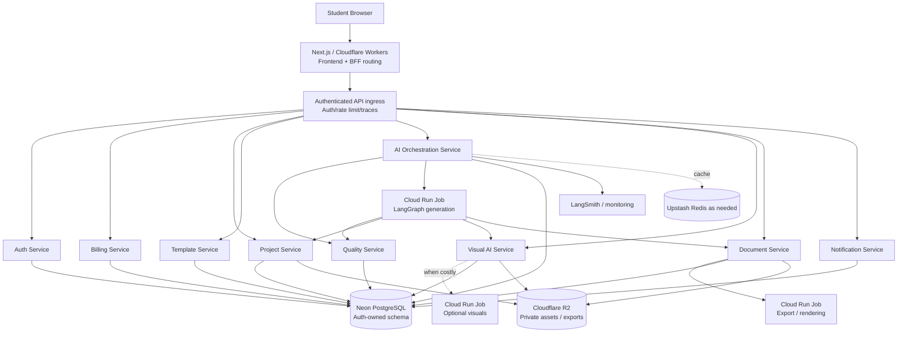
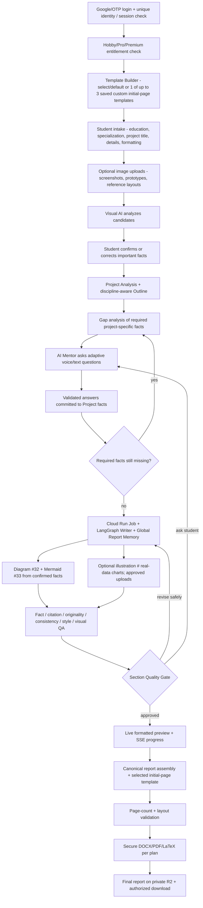
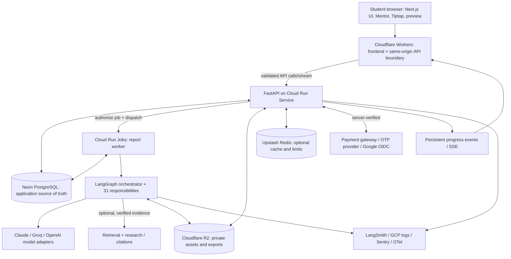
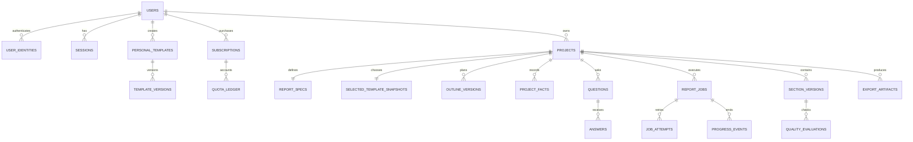
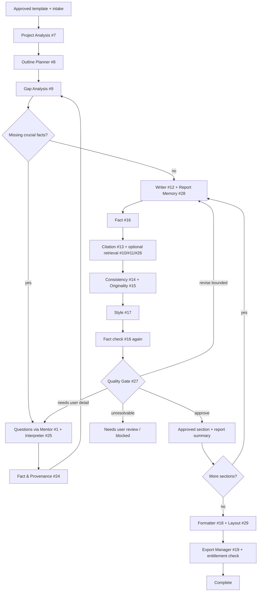

# Acadence — Complete System Architecture v1.1

**Decision:** Nine independently deployable backend microservices on Google Cloud Run; Next.js frontend on Cloudflare Workers; 36 coordinated logical agent/service responsibilities.  
**Status:** Architectural design baseline (approved direction, **not yet implemented or production-tested**).  
**Original references:** Complete v1.0 system design preserved in full later; Tech Stack v2.2 and Multi-Agent v1.1 are companion documents.

> **Read-first / precedence rule:** Sections in this **v1.1 update** supersede any v1.0 discussion of a single deployed FastAPI backend, single shared writeable domain store, 31 total roles, or the absence of visual generation and student-image inputs. **Every other original requirement stays mandatory**. The entire previous v1.0 document is retained unchanged below, for cross-checking and audit. A listed service boundary is a firm architectural direction, not proof that provider SDKs, payment gateways or actual Cloud Run permissions have been configured.

## 1. Decision register and non-negotiable product rules

1. **Cloudflare Workers** continues to run the Next.js frontend and optional BFF route proxy. No return to Cloudflare Pages.
2. **Nine independent Python/FastAPI Cloud Run Services:** Auth, Billing, Project, Template, AI Orchestration, Quality, Visual AI, Document, Notification. Independent containers, deploy pipelines, autoscaling and least-privilege service identities.
3. **Cloud Run Jobs** remain for long AI generation, heavy export and optionally visual jobs; one AI LangGraph controller (#23), PostgreSQL checkpointer and durable job/section records. Job waiting for student input must checkpoint and **exit**, not bill for idle compute.
4. **36 responsibilities**: the original 31 preserved, new #32 diagram generator, #33 diagram rendering/validation, #34 uploaded-image understanding, #35 illustrative AI image generator, #36 visual asset manager. Not 36 separate HTTP processes/LLMs.
5. **Student screenshots/photos/diagrams/layout references** become supported upload inputs, enabling fact clarification before report writing. Vision results are **candidate facts**, not asserted as a student's implementation until student confirmation.
6. **Mermaid library** is the first choice for diagrams/flowcharts. Typed DiagramSpec + verified project facts → validated Mermaid → safe SVG/PNG; Mermaid API conditional. Real numeric charts require actual data; diffusion illustrations remain explicitly illustrative, never claimed as evidence or fabricated results.
7. **Unchanged core:** Google or phone OTP login; strict normalized unique identity and device anti-abuse goal (browser limitation explicitly documented); Hobby 1 preview-only ≤10-page report, Pro 1 ≤100-page project DOCX/PDF, Premium 2 ≤100-page projects DOCX/PDF/LaTeX; backend-enforced entitlements; protected application pages; detailed educational/project intake; discipline-aware outline; adaptive gap-driven voice/text questions; no invented student-specific facts; section-by-section original LLM prose; similarity, factual, citations and quality checks; university template-builder tab with max 3 saved personal initial-page templates; immediate formatted preview; progress tracker, recovery; institutional format fidelity targets.
8. **Single shared infrastructure can still fail:** Neon PostgreSQL, R2, cloud region, gateway and network are shared failure domains until replicated/multi-region mechanisms are built. Microservices reduce blast radius but do not mathematically guarantee total isolation.
9. **Selected implementations stay selected;** payment vendor, SMS provider, voice model, diffusion provider, licensing and exact library patches remain undecided until evaluated.

## 2. Current deployment topology



**Diagram semantics:** Lines to Neon represent access to **each service's own schema/role**, *not* permission to update other services' tables. The diagram is logical; it does not require every operation to synchronously call every service. Quality, Visual and Document work can be asynchronous. The Next.js frontend never gets internal Cloud Run credentials, direct DB credentials or long-lived R2 secrets. BFF-to-GCP ingress authorization must be explicitly designed and tested; Cloudflare Workers do **not** automatically carry GCP IAM identity.

### Service deployment boundaries (firm)

| Service | Owns authoritative records/actions | Must not directly do |
|---|---|---|
| Auth | Users, verified identity bindings, phone OTP verification state, sessions, revocation, device/risk signals | Change Billing entitlement or project factual content |
| Billing | Plan definitions, active subscriptions from verified provider events, financial ledger, quotas, reservation/settlement | Allow LLM to confirm payments; edit project content |
| Project | Projects, academic context, fact ledger/provenance, typed/spoken answers, questions, upload references and student confirmation | Decide paid entitlement; modify Template version without Template API |
| Template | University-style default library, personal templates, page-block ordering, user cap of 3 custom initial-page templates, immutable chosen snapshot | Change generated chapters or quota ledger |
| AI Orchestration | AI state, outline and section workflow, report jobs/attempts, LangGraph checkpoints, memory, retries/recovery/progress and AI model usage | Accept unconfirmed image observations as facts; grant downloads |
| Quality | Citation/source/claim checks, originality/similarity results, fact consistency, section approvals; optional search tools | Silently alter student's canonical facts or overwrite settled chapter versions |
| Visual AI | Image ingest/vision processing, structured diagram rendering, image-generation provider, charts/visual assets/approvals | Claim AI illustration is a real experiment or student screenshot |
| Document | Canonical document assembly/preview conversion, pagination, DOCX/PDF/LaTeX export artifacts, layout QA, export permissions rechecked against Billing | Recreate/charge the AI report or bypass plan restrictions |
| Notification | OTP send jobs, report/payment notices, retryable delivery and communication preference state | Authenticate users or independently determine payment success |

**Shared concerns:** Safety & Policy Guard #31 must be implemented in **each service**, not trusted to a universal AI agent. Project and Billing remain separate even though they share a database instance. Notification may deliver OTP, but Auth owns issuance, verification and rate limits. Document re-verifies current entitlement before producing a short-lived download grant.

## 3. Data boundaries and database design extensions

**Database approach (selected):** One Neon PostgreSQL instance initially, separate schemas (`auth`, `billing`, `project`, `template`, `orchestration`, `quality`, `visual`, `document`, `notification`) and distinct DB roles/permissions. Each service owns migrations via Alembic within its schema. For cross-service access, use internal APIs/event projections; **no cross-service direct writes or shared ORM transaction**. Enforce per-project ownership and tenant checks at every API. Normalize identifiers via application logic and schema uniqueness constraints.

### Additional visual and distributed-operation tables / records

| Owner | Table or record family | Key fields and constraints |
|---|---|---|
| `project` | `project_uploads` | `id`, `owner_id`, `project_id`, `purpose` (evidence/layout/reference), `file_ref`, `mime_detected`, `size_bytes`, `sha256`, `status`, `consent_basis`, `created_at`; validate ownership and upload completion. |
| `project` | `candidate_image_observations` | `id`, `upload_id`, `vision_model`, `observation`, `region`, `confidence_or_uncertainty`, `question_id`, `confirmation_status`, `fact_id`; candidate until confirmed. |
| `project` | `project_facts` / `fact_provenance` (existing) | `fact_id`, `value`, `confirmed_by`, `confirmed_at`, `source_type` (typed answer, confirmed uploaded image, etc.), `source_id`, `revision`, `superseded_by`; only Project may promote facts. |
| `visual` | `visual_assets` | `id`, `owner_id`, `project_id`, `kind`, `origin`, `content_hash`, `r2_key`, `asset_version`, `rights_status`, `approved`, `caption`, `alt_text`, `source_ref`, `linked_section_id`, `created_at`. |
| `visual` | `diagram_specs` | `id`, `project_id`, `section_id`, `diagram_kind`, `spec_json`, `fact_refs`, `mermaid_source_ref`, `renderer_version`, `validation_state`, `svg_ref`, `png_ref`. |
| `visual` | `image_generation_requests` | `id`, `project_id`, `section_id`, `prompt_version`, `model_id`, `provider`, `intended_purpose`, `request_status`, `cost`, `result_asset_id`, `idempotency_key`. |
| `visual` | `data_chart_specs` | `id`, `project_id`, `section_id`, `dataset_ref`, `units`, `transformation`, `plot_version`, `approved`, `result_asset_id`; no fabricated values. |
| `document` | `document_figures` | `document_id`, `asset_id`, `section_id`, `placement`, `caption`, `alt_text`, `figure_number`, `render_asset_version`, `required`. |
| `orchestration` | `service_task_requests` | `task_id`, `origin_service`, `target_service`, `request_version`, `job_id`, `idempotency_key`, `state`, `attempts`, `last_error`, `deadline`, `trace_id`. |
| Every service | `outbox_events`, `inbox_deduplication` (where necessary) | `event_id`, `aggregate_id`, `event_version`, `event_type`, `payload_ref`, `published_at`, `consumed_at`; do not assume exactly-once external message delivery. |
| All | `audit_events` | Actor, service identity, project, object, action, result, timestamp; redact protected secrets and raw sensitive media. |

Use opaque asset IDs and typed, signed, short-lived scoped access URLs. **Never pass raw R2 credentials, unrestricted cross-schema DB connections or external model keys to the browser or LLM agent prompts.** Encrypt/sanitize sensitive uploads and set deletion/retention rules.

### Interservice consistency

- **Billing** transactionally reserves an entitlement (idempotency key: user + project + logical generation intent) and returns `reservation_id`. **AI Orchestration** uses that ID to create its job, persists job state, and sends a settlement/cancellation command only after the correct terminal transition. Billing alone decides quota ledger state; ambiguous outcomes are reconciled, not guessed.
- **Template** versions are immutable after selection; Project and Document access snapshots by ID and version. A later template edit cannot silently modify a report already being generated.
- **Project** fact revisions emit versioned `project.facts.updated`; AI orchestration marks dependent sections/diagrams/observations stale. Quality and Document never treat stale outputs as approved.
- **Visual** publishes `visual.asset.approved` or `visual.asset.failed`, with provenance; Document consumes an asset ref, not untrusted Mermaid HTML or external URL from a model.
- **Quality** emits/replies with a structured verdict bound to `section_version`, `fact_snapshot_version` and optionally visual/source version. A stale acceptance cannot approve a newer section.
- **Export** failures do not consume another paid project: document render/execution retries are idempotent and separate from the initial project reservation.

## 4. Network, authentication and message patterns

1. **External:** Browser → Cloudflare Workers frontend/BFF → selected API ingress → specific Cloud Run services. JWT/session validation, CSRF where applicable, CORS, HSTS/TLS, request limits and tenant ownership checks. BFF is not a trusted identity assertion by itself.
2. **Internal synchronous calls:** Service → private Cloud Run Service using a **Google-issued audience-bound ID token** and least-privilege `roles/run.invoker`, with separate service identity. Validate task/user context **inside** the receiver too. Client calls have finite deadlines and circuit-breaker/backpressure patterns. <https://docs.cloud.google.com/run/docs/authenticating/service-to-service>
3. **Asynchronous one-target jobs:** **Cloud Tasks** is the preferred candidate for delayed or rate-limited HTTP task dispatch, when required, with authenticated delivery. Do not place a Cloud Run **Job** in a permanently waiting-for-student loop; checkpoint and return first.
4. **Fan-out event subscribers:** **Pub/Sub** optional when two or more services truly need the same event. If adopted, implement outbox and consumer idempotency with published event schemas. Cloud Tasks and Pub/Sub solve different problems; not necessary to enable both on day one.
5. **Long AI job:** FastAPI AI Orchestration starts a Cloud Run Job execution; job gets limited permissions to reach Project/Quality/Visual/Document or service-owned projections, persists progress to its own schema and LangGraph checkpoints.
6. **SSE:** API emits durable `progress_event` IDs; reconnect via cursor/last-event-ID; polling fallback. Event content includes only permitted user-safe metadata, not internal prompts/secrets or raw participant images.
7. **Observability:** propagate `trace_id`, `request_id`, `job_id`, `project_id` and `service` names through OpenTelemetry/Cloud Logging/LangSmith without leaking sensitive data.

**Critical boundary:** Cloudflare-to-GCP private service authentication has **not** been finally selected; do not assume Cloudflare Workers can automatically mint native GCP metadata-server ID tokens. A secure ingress approach needs a proof-of-concept, e.g. restricted public gateway with real auth and network security controls or a supported token broker/workload federation design. This is an OPEN integration decision and must be resolved before deployment.

## 5. Service-to-service API contract examples (proposal; not deployed)

**External routes through BFF and internal route groups are separated.** Endpoint naming below is a **draft contract**, designed to prevent Cursor from inventing ad-hoc interfaces. All writes include owner/permission and idempotency checks; all reads use versioned response contracts.

| Service | Public-facing API examples (when permitted) | Private API / event examples |
|---|---|---|
| Auth | `POST /v1/auth/google`, `POST /v1/auth/otp/request`, `POST /v1/auth/otp/verify`, `POST /v1/auth/refresh`, `POST /v1/auth/logout`, `GET /v1/auth/me` | `GET /internal/auth/subject/{id}` when needed; `user.registered`, `session.revoked` |
| Billing | `GET /v1/plans`, `GET /v1/entitlements/me`, `POST /v1/checkout`, provider `POST /v1/webhooks/payments` | `POST /internal/quotas/reserve`, `/settle`, `/release`, `entitlement.changed` |
| Project | `POST /v1/projects`, `PATCH /v1/projects/{id}`, `POST /v1/projects/{id}/answers`, `POST /v1/projects/{id}/uploads/intent`, `/uploads/{assetId}/confirm`, `GET /v1/projects/{id}/facts` | `GET /internal/projects/{id}/fact-snapshot`, `POST /internal/projects/{id}/proposed-facts`, `project.facts.updated` |
| Template | `GET /v1/templates/defaults`, `POST /v1/templates/personal`, `PATCH /v1/templates/{id}`, `POST /v1/projects/{id}/template-selection` | `GET /internal/template-snapshots/{id}`, `template.snapshot.selected` |
| AI Orchestration | `POST /v1/projects/{id}/plan`, `POST /v1/projects/{id}/questions/resume`, `POST /v1/projects/{id}/generate`, `GET /v1/report-jobs/{id}`, `GET /v1/report-jobs/{id}/events` | `POST /internal/section-tasks`, `section.draft.saved`, `section.approved` |
| Quality | `GET /v1/reports/{id}/quality-summary` (authorized) | `POST /internal/quality/evaluate-section`, `POST /internal/quality/evaluate-citation`, `quality.section.reviewed` |
| Visual AI | `POST /v1/projects/{id}/visual-assets`, `POST /v1/projects/{id}/diagram-requests`, `POST /v1/projects/{id}/illustration-requests`, `GET /v1/visual-assets/{id}` | `POST /internal/vision/analyze-upload`, `POST /internal/diagrams/render`, `visual.asset.approved` |
| Document | `GET /v1/projects/{id}/preview`, `POST /v1/reports/{id}/exports`, `GET /v1/reports/{id}/exports`, `GET /v1/exports/{id}/download` | `POST /internal/documents/assemble`, `POST /internal/layout/validate`, `export.completed` |
| Notification | `GET /v1/notifications` | `POST /internal/notifications/send`, `notification.failed` |

**Example diagram request:**
```json
{
  "project_id": "prj_123",
  "section_id": "sec_implementation",
  "kind": "flowchart",
  "fact_snapshot_version": 8,
  "fact_ids": ["fact_02", "fact_04"],
  "intent": "Describe the student-confirmed attendance workflow",
  "requested_formats": ["svg", "png"],
  "idempotency_key": "diagram:prj_123:sec_implementation:8"
}
```

**Example upload-processing result:**
```json
{
  "asset_id": "asset_400",
  "origin": "student_uploaded",
  "usage": "actual_project_screenshot",
  "status": "requires_student_confirmation",
  "candidate_observations": [
    {"claim": "The screen appears to include an attendance table", "source": "asset_400", "confirmed": false}
  ],
  "promoted_fact_ids": []
}
```

**Exactly one source of truth for confirmed facts:** The Project Service owns confirmation and source tracking, independent of where the observation originated. An uploaded photo by itself may show appearances, not prove implementation internals.

## 6. End-to-end user journey with new visual stages (old journey preserved)



**Scheduling nuance:** The Template Builder is a **separate UI tab**, and saved initial pages are **merged at final assembly**; their approved layout rules guide live preview from the start. Student image upload can happen during intake, adaptive questioning, or report review, and is optional by default. Figure generation is **not** automatically forced for every section: use only when justified by a real outline requirement or student preference.

**Quality order unchanged:** Draft → fact check → source/citation checks when relevant → consistency/repetition/originality checks → natural style edit → **second fact check** → section quality gate (approve/revise/ask user/blocked). Images and diagrams receive added semantic/provenance/rights and layout checks. A failed *required* diagram can block final approval; an optional conceptual image failure should not erase a report.

## 7. Secure student image uploads and provenance (new requirement)

1. **UI:** Accept clearly explained image purposes, captions, and an explicit distinction between actual project material and inspiration/example material. Avoid asking users to upload confidential data casually. For clinic/health/participant images, require a more stringent privacy/legal consent workflow and allow a no-upload alternative.
2. **Authorization:** Project Service validates session, owner, project state, upload limits and permitted type; returns a constrained, short-lived R2 upload intent. Server verifies final object before use. No permanent public bucket links.
3. **Validation:** Content-type sniffing, file signatures, dimension/pixel count, allowable formats, size bounds, decompression-bomb checks, metadata removal including GPS/EXIF where appropriate, active content/script prevention, malware scanning depending on threats and resources. Render uploaded SVG only with a strict sanitization policy; an image upload is not a trusted instruction to a model.
4. **Vision:** #34 extracts candidate facts, descriptions, possible text labels and uncertainty; if details can be read safely from embedded image text, parse them carefully. Students review and confirm factual interpretations before #24 stores them canonically.
5. **Use:** #36 stores owner/rights/origin/version/caption/alt text; #12 Chapter Writer references approved image info only, #16 Fact Validation checks narrative alignment; #18 inserts it using the canonical figure nodes in DOCX/PDF/LaTeX.
6. **Privacy:** Retention/withdrawal, rights, provider agreements, access logs and secure deletion procedures; never leak participant or patient images to external model providers without appropriate protection and consent.

## 8. Diagram, chart, and image generation architecture

| Visual category | Generation / validation path | What it must not do |
|---|---|---|
| Mermaid flowchart, ER, architecture, sequence, state, class | #32 structured spec from *confirmed facts* → #33 validate/compile Mermaid → SVG/PNG → #36 asset record → #27 gate → #18 export | Guess database tables, algorithms, network components, study procedure or results |
| Actual screenshot/prototype photo | Student upload → R2 → #34 observations → Student confirmation → #24 fact ledger → #36 figure | Assert hidden backend, database, measurements or participant consent from pixels |
| AI conceptual illustration | #35 provider-neutral image API (FLUX.2 candidate) → label illustrative → student review as needed → #36 | Present diffusion art as actual research evidence, medical image, experiment photo or student's implementation |
| Real-data graph/chart | Matplotlib or Plotly from verified data with units and dataset provenance → #36 | Fabricate numeric values or imply a model generated chart is measured data |

**Mermaid security:** initialize with `securityLevel: 'strict'` unless using a stricter vetted sandbox; restrict links/HTML and script injection; lint/validate Mermaid source and sanitize SVG before serving to browser or including in exports. Prefer version-pinned renderer and fonts so preview/export look consistent. Mermaid JS is selected; a third-party Mermaid API is conditional, not mandatory.

**Document integration:** Canonical figure node must preserve `asset_id`, `asset_version`, `kind`, `caption`, `alt_text`, `source/provenance`, size constraints, section placement, figure numbering and academic citation references where necessary. Preview may use SVG; DOCX/PDF/LaTeX may need safe raster or vector conversion. Layout Validator #29 checks overflow, broken links, image dimensions and caption/TOC/List-of-Figures consistency if included.

## 9. Reliability, failure isolation, security and observability

| Failure | Required response | Owner |
|---|---|---|
| Cloudflare frontend disconnects | Save client draft where possible; job persists; reconnect SSE/poll; no duplicate generation | Frontend + AI Orchestration |
| Auth unavailable | Reject operations needing fresh authorization; never use model judgment as identity | Auth + each receiving service |
| Billing unavailable | Do not grant new paid access or consume unknown quotas; reconcile pending reservation after recovery | Billing + AI Orchestration |
| Student uploaded unreadable/unsafe image | Mark failed and request safe re-upload, not hallucinated image description | Project + Visual AI |
| Diagram invalid | Preserve figure spec, bounded repair, ask missing facts, possibly block mandatory figure | Visual AI + Quality |
| AI image provider fails | Record optional asset failure; core report remains intact; user informed | Visual AI + Progress |
| Citation verification provider unavailable | Do not claim citation verified; save pending review | Quality |
| Plagiarism corpus unreachable | Do not claim zero similarity; hold mandatory originality gate where contract requires | Quality |
| Quality Service unavailable | Draft kept, approval pending; eventual retry, no falsely approved section | AI Orchestration + Quality |
| Document Service unavailable | Final sections retained, queue export retry, no duplicate paid project consumption | Document + Billing |
| Cloud Run Job killed / 429 / model error | Checkpoint, bounded retries, idempotent step status and resume from approved work | AI Orchestration |
| Notification Service unavailable | No fake payment/report-ready messages; other work can complete | Notification |
| Neon/R2 outage | Durable backoff, outage status and recovery; explicitly shared failure domain | Operations |

**Security rules:** Per-service GCP identities and private IAM between Cloud Run services; no shared broad admin secrets; authorization per tenant/project at every service; limited R2 grants; anti-abuse and rate limits; webhook signatures; strict data-sharing to external AI services; prompt-injection defenses for uploaded/retrieved content; output validation, XSS protection for rich text/Mermaid/SVG; PII/clinical data treatment and retention. Sentry, OpenTelemetry, Cloud Logging/Monitoring, LangSmith and audit events remain part of observability, but must not record unredacted sensitive media/answers by default.

## 10. Cursor monorepo and independent release management

```text
acadence/
├── apps/
│   └── frontend/                     # Next.js on Cloudflare Workers; editor, Mentor, preview
├── services/
│   ├── auth-service/
│   ├── billing-service/
│   ├── project-service/
│   ├── template-service/
│   ├── ai-orchestration-service/
│   ├── quality-service/
│   ├── visual-ai-service/
│   ├── document-service/
│   └── notification-service/
├── workers/
│   ├── report-generation/           # Cloud Run Job with LangGraph checkpoints
│   ├── document-export/             # Cloud Run Job / heavy export
│   └── visual-processing/           # optional Cloud Run Job only if justified
├── packages/
│   ├── api-contracts/               # OpenAPI / JSON Schema / generated TypeScript types
│   ├── event-contracts/             # versioned event schemas, no shared DB models
│   └── shared-types/                # minimal utilities, not common domain ORM
├── infrastructure/
│   ├── cloudflare/
│   ├── cloud-run/
│   ├── iam/
│   ├── queues/
│   ├── monitoring/
│   └── database-migrations/
├── tests/
│   ├── contract/
│   ├── integration/
│   ├── isolation/
│   ├── resilience/
│   ├── e2e/
│   └── ai-evaluations/
└── docs/
    ├── ACADENCE_TECH_STACK_V2_2.md
    ├── ACADENCE_MULTI_AGENT_ARCHITECTURE_V1_1.md
    ├── ACADENCE_SYSTEM_ARCHITECTURE_V1_1.md
    └── adr/
```

**Independent CI:** Path-based builds and service-specific tests, versioned container images, migrations only for owner schema, staged deployment, independent rollback and traceable dependency versions. Require OpenAPI/consumer-contract checks and message schema compatibility before merging changes. Run end-to-end tests spanning all services and disaster recovery exercises.

## 11. Updated acceptance suite and requirements audit

- [ ] All nine services independently start/stop/scale/deploy and have documented ownership, resource limits, health endpoints and least-privilege DB/IAM identities.
- [ ] A service cannot write another service's schema; event and API consumers reject invalid/old versions.
- [ ] Cloudflare BFF-to-Cloud Run ingress has an implemented and tested auth model; no exposed unrestricted internal endpoints.
- [ ] Cloud Tasks/PubSub (if enabled) are retry-safe, deduplicated and reconciled; long human pauses don't run a billed Cloud Run Job.
- [ ] Google and OTP sign-in, duplicate email/phone prevention, device policy with browser limitation, protected routes and account recovery behave as previously specified.
- [ ] Hobby: 1 report ≤10 pages preview-only; after trial no subscription → pricing. Pro: 1 project ≤100 pages DOCX/PDF. Premium: 2 projects ≤100 pages each DOCX/PDF/LaTeX; concurrent creation and billing retries don't double-spend quotas.
- [ ] University Template Builder is a **separate tab**, allows max 3 personal saved initial-page templates, has default templates, independent drag/drop/add/duplicate/delete page blocks, layouts/logos/signatures and accurate preview; selected snapshots merge with final report.
- [ ] Initial academic context supports any discipline. Outline/gap analysis asks missing, relevant questions only, voice/text answers persisted and clarified, never assumes a technology, research method or result.
- [ ] Student can upload images at intake and during Q&A; secure private upload, rights/consent, vision candidate facts, student confirmation, and approved report figure insertion all work.
- [ ] #32 produces only fact-grounded diagrams; #33 returns safe Mermaid SVG/PNG and rejects invalid/hostile syntax; #34 does not invent hidden implementation; #35 labels illustrative art; #36 preserves figure origin/approval/caption/alt text.
- [ ] Citation #13, Source Verify #26, plagiarism/originality #15, Facts #16, Consistency #14, Style #17, Report Memory #28 and Quality Gate #27 remain separate checks; post-style facts revalidated.
- [ ] Generation preview, realistic progress, speaking AI Mentor, retry/cancel/reconnect, recovery/checkpoints and document-specific export state remain operational across service faults.
- [ ] Canonical document model produces acceptable DOCX/PDF/LaTeX template fidelity, actual page limits, figure captions/numbering and supports selected initial pages; missing required assets block final approval.
- [ ] Every original **31/31** role and requirement is retained; new roles **32–36** have formal task contracts, tests and owner mappings; total **36** accounted for.

## 12. Open design choices (must not be silently decided)

- Provider, country coverage, price and compliance of mobile OTP service; payment gateway/renewal/refund and plan revision rules; clinical/sensitive-image privacy and consent approach.
- Tiptap Pages paid beta versus custom page layout, conversion/rendering fidelity, SVG-to-DOCX/LaTeX and headless Mermaid renderer container/CLI operational footprint.
- Image provider/model (FLUX.2 Cloudflare AI as candidate; alternate BFL/fal/Stability), vision provider/model, source/reference image copyright/rights, explicit image generation controls and costs.
- File format, max upload size/count/dimensions, image cleanup/EXIF handling, scan service, retention/deletion schedule.
- Choice of GCP secure ingress from Cloudflare Worker and tested per-service IAM; Cloud Tasks for dispatch, conditional Pub/Sub for fan-out, visual export job scheduling.
- Actual pinned patch versions of Next.js 16, vinext, React, Tiptap, Mermaid, FastAPI, LangGraph, model SDKs; production compatibility not yet demonstrated.
- External plagiarism provider/corpus, citation sources needed per discipline, human review requirements for clinical/legal projects, voice STT/TTS vendor and accessibility design.

**Validated documentation links:**
- [Google Cloud Run: authenticating service to service](https://docs.cloud.google.com/run/docs/authenticating/service-to-service)
- [Mermaid: rendering security configuration](https://mermaid.js.org/config/usage)
- [Cloudflare AI: FLUX.2](https://developers.cloudflare.com/ai/models/black-forest-labs/flux-2-pro-preview/)

---

## Preserved System Architecture v1.0 — full original text (historical where explicitly superseded)

> The entire former architecture follows unchanged to ensure earlier requirements, examples, validation conditions and security caveats are not accidentally dropped. All service boundaries, current role counts and visual workflows in **v1.1 above** take precedence over conflicting older details.

# Acadence — Complete System Architecture v1.0

**Architecture date:** 2026-11-11  
**Status:** Design baseline proposed for implementation. **Not** a claim that packages, production deployment, or export fidelity have been tested.  
**Companion source-of-truth documents:**
- `ACADENCE_TECH_STACK_V2_1.md` — chosen tools, version targets, conditional dependencies, complete product invariants.
- `ACADENCE_MULTI_AGENT_ARCHITECTURE_V1_0.md` — the 31 roles, boundaries, validation rules and coordination model.

**Change rule:** Never silently remove, replace, or downgrade a product requirement or a selected technology. Record a decision/ADR, impact, tests and explicit approval. Where exact provider, package, licensing or business policy remains unconfirmed, mark `OPEN` instead of inventing a decision.

## 0. Product definition and architectural invariants

Acadence is a voice-enabled, conversational, multi-disciplinary academic report-generation platform. LLMs primarily **write the report prose**. They do **not** get to invent facts about the student's actual work. The platform first chooses a university-style preliminary-page template, collects project information, plans a discipline-specific outline, identifies information gaps, asks only relevant adaptive questions, saves confirmed facts, then generates, checks, previews, and conditionally exports the report. Students must be able to resume interrupted work and see real progress.

**Must always hold:**
1. Google OIDC and verified mobile OTP sign-in; no duplicate verified email or number; a strict *business objective* of one account per device, with explicit technical limits of browser-only device identification and privacy-conscious abuse enforcement.
2. All private screens and APIs require session and ownership checks; public pages only where explicitly designated.
3. Hobby = one preview-only report **up to 10 pages**, **zero downloads**; after consumption and no active paid entitlement, show pricing. Pro = **one** complete project **up to 100 pages**, DOCX + PDF. Premium = **two** complete projects **up to 100 pages each**, DOCX + PDF + LaTeX. Server-authoritative enforcement.
4. Separate university **Template Builder tab before AI adaptive questioning**; default templates, at most **3 personal saved preliminary-page templates per user**, arbitrary numbers of editable pages inside a personal template; choose one, freeze a snapshot for the report, and merge it into the final product. The selected layout guides live preview before final assembly.
5. The editor supports independently editable/reorderable/duplicable/insertable/removable page blocks for cover, certificate, declaration, acknowledgement, abstract, table of contents, chapter page layout, bibliography, appendix, and custom pages. Styles include page dimensions, margins, headers, footers, logos, signatures, images/tables, typography, spacing, alignment and numbering.
6. Support Diploma, Engineering, LLB, Psychology, MBBS and any appropriate academic discipline, not a fixed software-only outline.
7. AI analyzes initial data, generates an appropriate report structure, determines section fact requirements, runs gap analysis, then asks missing project-specific questions through a typed/spoken AI Mentor. Already-known answers are never needlessly re-asked. Save answers with provenance and clear confirmation status.
8. Never fabricate project-specific technology, methods, hardware, architecture, participants, experiments, measurements, testing results or conclusions. If critical information is unknown, ask, mark unknown or omit unsupported assertions.
9. Check each section for fact alignment, internal and cross-chapter repetition, appropriate citations when required, originality issues, coverage, consistent terminology and natural academic readability. Revise within a finite budget; no guarantee of zero plagiarism or AI-detector evasion.
10. Provide incremental formatted previews and truthful progress/status narration, including draft/approved distinctions, online/offline recovery, rate limits, failures, retries, cancellations and resumable jobs.
11. Final content and university formatting compose into DOCX/PDF and, for Premium, LaTeX; actual page limits are checked against rendered output. Direct file URLs may not bypass authorization.

## 1. Selected technology boundaries

| Layer | Primary implementation | Ownership/constraint |
|---|---|---|
| Web UI | Next.js App Router (16.x target), React, TypeScript, Tailwind CSS, shadcn/ui | Hosted **Cloudflare Workers**, not Pages; `vinext` remains compatibility-gated beta. |
| Client data | Redux Toolkit/RTK Query where shared state is needed; React Hook Form + Zod | Client checks are UX only, never authorization. |
| Template editor | Tiptap 3/ProseMirror, dnd-kit, custom page-block/layout schema | Tiptap Pages/Conversion are **conditional paid beta** candidates. |
| Business API | FastAPI, Python 3.13, Pydantic 2, SQLAlchemy 2, psycopg 3, Alembic | **Google Cloud Run Service**; tenant-aware, validated REST APIs. |
| Long-running generation | Cloud Run Jobs executing Python + LangGraph, selective LangChain | Durable state in Neon Postgres; no report generation kept inside an HTTP request. |
| Models | Anthropic Claude, Groq-hosted models, OpenAI alternatives | Task routing decided by benchmark; no hardcoded model quality guarantees. |
| AI observability | LangSmith | Traces/evals with sensitive input redaction. |
| Database | Neon PostgreSQL + pgvector | Canonical user, billing, fact, content, template and job truth. |
| Cache/rate limiting | Upstash Redis when useful | Never sole store of user entitlements or job completion. |
| Binary assets | Cloudflare R2 | Private source files, template assets, previews and exports. |
| Report outputs | Canonical report model -> python-docx / ReportLab or conversion / Tectonic LaTeX | Fidelity must be measured, not presumed identical. |
| Operations | Docker, Git/GitHub, GitHub Actions, Google Cloud Monitoring/Logging, LangSmith, Sentry, OpenTelemetry | Environment-specific secrets/IAM, tests, telemetry. |
| Speech | STT and TTS adapter with possible OpenAI Realtime or Web Speech fallback | **Provider OPEN**; voice must not be sole way to answer. |
| Payments | Payment provider adapter (Razorpay/Stripe candidates) | **Provider OPEN**; verified gateway events only. |

**Technology version rule:** The references identify version *targets*, not a fully verified patch matrix. Pin concrete versions after an integration spike; use `pnpm-lock.yaml` and a Python lockfile. `vinext` is beta; run its compatibility check, Workers deployment spike and auth/SSE/editor/browser tests before a production declaration.

## 2. High-level topology and trust boundaries



### Concrete request paths

- **Browser -> Workers -> FastAPI:** Prefer a same-origin `/api/v1/*` Worker proxy/BFF boundary to avoid scattering credentials across cross-domain JavaScript fetches. Keep the authoritative session validation **in FastAPI**; a Worker route guard improves UX but is not the security authority. Set trusted proxy headers deliberately; do not expose internal Cloud Run credentials to the browser.
- **Authentication:** Browser begins Google OIDC or verified OTP via proxied API; callback issues server-managed session with secure `HttpOnly`, `Secure`, appropriate `SameSite` cookies. State-changing requests use CSRF defense if cookie-authenticated. Explicitly test redirects and cookies across Workers/Cloud Run.
- **Generation:** Browser submits project/job start request; FastAPI authorizes, transactionally reserves entitlement and writes durable job record; a trusted dispatcher starts a **Cloud Run Job** with only a job ID. Worker reads its own secrets and DB records, never user-supplied arbitrary command or model credentials.
- **Progress:** Worker appends durable events to PostgreSQL; frontend subscribes via `GET /api/v1/jobs/{job_id}/events` (SSE, user scoped) or polls status if proxy/connection limitations arise. Never stream raw internal secrets or chain-of-thought.
- **Downloads:** API authorizes ownership and plan *at request time*, then issues short-lived private R2 link or protected streamed response. All R2 objects private by default.
- **No unrestricted inter-agent chat:** LangGraph invokes typed role functions; PostgreSQL holds confirmed facts, outline, approved drafts and validated sources. Agents exchange **references and structured outputs** rather than editing each other's memory.

### Security boundaries

1. Browser input is untrusted; Zod is UX, Pydantic+database rules are authoritative.
2. Workers is a public web edge, not a substitute for API authentication or billing enforcement.
3. FastAPI uses user/principal identity and tenant scoping on every protected operation.
4. Cloud Run worker uses a distinct limited service identity and short-lived credentials; LLM tools cannot call arbitrary database or billing operations.
5. Retrieved documents, uploaded files, external webpages and voice transcripts are **data**, not instructions for the model to change platform policies.

## 3. Domain modules and ownership (31/31 roles)

The 31 are **responsibilities**, not 31 separately deployed agents. Seven roles use LLM reasoning; nine combine reasoning and hard checks; 15 are deterministic services/controllers. See the companion agent document for formal output boundaries.

| IDs | Domain/module | Responsibility and operational owner |
|---|---|---|
| #1 | Mentor experience | Only student-visible bot; UI/voice narration from *actual* progress events. |
| #2, #31 | Identity, session and security | OIDC/OTP, uniqueness, sessions, device abuse, route/API authorization, policy, audit. |
| #3, #4, #30 | Billing, payments and quota | Active entitlements, provider-verified payments, transactional project reservation, settlement. |
| #5 | Notifications | OTP, payment/failed-job/ready notifications, consent/preferences. |
| #6, #29 | Templates and layout validation | Default/personal templates, three slots, page blocks, snapshot, layout checks. |
| #7, #8, #9 | Project intelligence | Discipline understanding, outline, required facts, adaptive gap and questions. |
| #24, #25 | Facts and answers | Parse typed/voice answers; validate, confirm, version and attribute facts. |
| #10, #11, #26 | Optional research | Hybrid search, relevance ranking and source/evidence verification. |
| #12, #28 | Generation and memory | Chapter writing and persistent global report coverage memory. |
| #13, #14, #15, #16, #17, #27 | Content quality | Citation, consistency, originality, facts, editorial rewriting and quality gate. |
| #18, #19 | Document composition/export | Canonical layout rendering, DOCX/PDF/LaTeX exporters, download access. |
| #20, #21, #22, #23 | Workflow/reliability | LangGraph dispatch, persistence/recovery, retry policy and SSE progress. |

**No AI role may grant a subscription, spend a quota, approve a payment, revoke a session, access an unrelated student's project, or bypass export checks.**

## 4. Data architecture: PostgreSQL records and relationships

Use normalized relational tables plus versioned JSONB for flexible multi-disciplinary facts, templates and report trees. Every user-owned row either carries `owner_user_id` or has a clearly enforced parent foreign key. No raw SQL generated by an LLM. Use migrations, explicit indexes and transactions.

### 4.1 Essential tables and representative columns

| Table(s) | Key fields / invariants |
|---|---|
| `users` | `id`, `status`, `created_at`, `hobby_trial_status`; no implicit email-as-user-id. |
| `user_identities` | `id`, `user_id`, `provider`, `provider_subject`, verified normalized email; unique `(provider, provider_subject)`; unique verified normalized email across accounts. |
| `phone_identities`, `otp_challenges` | verified E.164 phone unique; OTP challenge hashed, expires, attempt count, throttling, one-time use. |
| `sessions`, `refresh_tokens` | token hash, user/device IDs, created/expiry/revoked, rotation family; no plaintext persisted refresh token. |
| `device_registrations`, `abuse_signals` | device-issued browser token/risk metadata, enrollment account, review flags, retention; no claim of unforgeable physical device identity. |
| `plans`, `plan_entitlements` | Hobby/Pro/Premium, max projects/pages and allowed export formats; versioned plan definitions. |
| `subscriptions`, `payment_events`, `payments` | provider/customer/subscription refs, status, effective period, verified webhook event uniqueness; store no card credentials. |
| `quota_ledger`, `project_reservations` | `user_id`, `entitlement_id`, `project_id`, `reservation_state`, `idempotency_key`, counted units; immutable accounting events. |
| `personal_templates`, `template_versions` | user-owned templates; **at most 3 active personal template slots per user** via transactional slot allocation; content version immutable. |
| `default_templates`, `template_page_blocks` | reviewed public designs and source/claim metadata; pages have stable IDs, type, order, ProseMirror JSON and layout constraints. |
| `projects`, `report_specs` | owner, education, discipline, specialization, title/description, known details, length target, template selection, formatting rules and current version. |
| `selected_template_snapshots` | `project_id`, template ID/version, immutable JSONB/layout asset refs, selected_at; generation reads snapshot. |
| `outline_versions`, `outline_sections` | approved hierarchy, objectives, required fact keys, estimated length, order, dependencies and version. |
| `fact_requirements`, `project_facts`, `fact_provenance` | typed key/value, discipline scope, `unknown/candidate/confirmed/disputed/superseded`, evidence from answer, confirmed_by, version. |
| `question_sessions`, `questions`, `answers` | gaps, question dependencies, asked/answered/skipped, typed/voice response transcript, corrections and confirmation. |
| `conversation_messages`, `agent_events` | student/mentor visible messages, stage explanation, moderation, timestamps; never sole truth for project facts. |
| `report_jobs`, `job_attempts`, `job_steps` | owner/project, entitlement reservation, execution ID, status, lease/heartbeat, attempts, resume key, failed reason. |
| `section_drafts`, `section_versions`, `section_summaries` | section ID, content tree/text, input fact/outline/prompt versions, approval, revision, covered concepts, output hash. |
| `quality_evaluations`, `similarity_hits` | checker, verdict, metrics, reference spans, source, input version, confidence, corrective request. |
| `research_sources`, `source_passages`, `claim_source_links` | source DOI/metadata, evidence location, claim reference, verification status; created only where applicable. |
| `document_snapshots`, `export_artifacts` | approved document tree/version, format, page count, hash, R2 object key, validation state. |
| `progress_events`, `outbox_events` | monotonic job-local or DB event sequence, event type and safe payload; reliable consumer delivery. |
| `model_usage`, `cost_records`, `audit_events` | model, prompt version, token counts, cost estimates, trace IDs, protected action audit (redacted). |
| `langgraph_checkpoint_*` | LangGraph-owned persistence tables managed by official Postgres checkpointer; application should not mutate directly. |

### 4.2 Relationship sketch



### 4.3 Hard invariants and concurrency

- Enforce unique normalized verified email, E.164 phone and OIDC `(provider, subject)` at **database level**; identity linking requires proof of control of both identities. Use partial unique indexes when a nullable/unverified field is present.
- Enforce **three saved personal template slots** using a locked user/template-allocation row or a `template_slot` constrained to 1..3 with unique `(user_id, template_slot)` for active templates. A mere application count is race-prone.
- Reserve the Hobby/Pro/Premium quota in a serializable or row-locked transaction; concurrent clicks must not create extra projects. Store unique idempotency keys and unique provider webhook IDs.
- Keep **fact version** and **document version**. A change to an approved fact marks dependent sections and validations stale; they must not reappear as approved by an outdated worker.
- Store **job step lease + heartbeat**. On a worker restart, use compare-and-swap/version checks before taking ownership. Do not treat Redis locking as the only safeguard.
- Emit progress/event records in the **same committed transaction** as their corresponding state changes where possible; a separate dispatcher may broadcast asynchronously.
- Design retention, deletion and user access requests across DB, R2, voice data and traces. No silent storage of sensitive patient/participant data.

## 5. Authentication, identity, protected routes and device policy

### Google OIDC

1. Student clicks Google login; backend creates signed/OIDC `state` and PKCE where applicable.
2. Google callback is validated for issuer, audience, nonce/state, time, signature and verified email claim before linking.
3. Within a transaction, find the existing provider subject/verified email; **log into the existing account** rather than creating a duplicate. Linking Google and phone identities requires verification.
4. Set server-issued secure session cookie; short-lived access and rotating, revocable refresh tokens. Endpoints return minimal profile; no tokens placed in query strings or localStorage.
5. All protected API reads/writes verify owner and session; revoked or expired sessions are rejected centrally.

### Mobile OTP

1. Normalize to E.164; apply device/IP/number throttling and challenge attempt limits.
2. Use selected OTP provider (**OPEN**) to send time-bound code; store a one-way proof/hash of challenge, not plaintext.
3. Verify exactly once; link to existing verified number/account or create first-time identity; prevent account enumeration in public errors.
4. For changes to email/number, require proof of both old and new identifiers or a documented recovery policy.

### One-device-one-account

Enforce the **business intent** using an issued device registration token, server-side device binding policy, abuse/risk throttling, per-device trial history and review/appeal mechanisms. **A website cannot securely prove a unique physical device**: cookies can be deleted, browsers are separate, private modes exist, and fingerprints can collide. Never pretend this is guaranteed. Keep data minimization and consent/privacy protections. A user with an existing registered email/number should always be directed to login/recovery, not a new account.

### Routes

- **Public:** marketing home, pricing, information/help/legal, authentication start/callback and explicitly public assets.
- **Authenticated:** dashboard, projects, templates, editor, AI Mentor/questions, preview, account, billing management and generation status.
- **Additional entitlement:** report start, some previews if job lacks access, and **all** exports; check in API, not merely UI.

## 6. Billing, subscriptions, trial and quota state

| Plan | Quota | Limit | Permission |
|---|---|---|---|
| Hobby | 1 trial report | <=10 actual pages | Preview only; no export URLs or files. |
| Pro | 1 complete project per entitlement period (period **OPEN**) | <=100 actual pages | DOCX, PDF. |
| Premium | 2 complete projects per entitlement period (**OPEN**) | <=100 actual pages per project | DOCX, PDF, LaTeX. |

`eligible -> reserved -> running -> completed/consumed` is the happy path. `reserved/running -> failed/canceled -> released_or_retriable` follows an explicit policy; **never charge quota twice for retries**. After Hobby is used, inspect active paid entitlement, else redirect/show pricing. Reports already created and their future export rights need an explicit retention/access decision (OPEN).

**Start-job transaction example:**
1. Verify session, owner, immutable template selection and filled mandatory intake fields.
2. Lock applicable entitlement/project reservation row; ensure requested page budget and project count fit plan.
3. Reuse prior job for the same `Idempotency-Key` rather than consuming another unit.
4. Write quota reservation + report job + start event atomically; dispatch with outbox or reliable reconciliation.
5. Mark quota consumed on a defined success milestone; failed/retried jobs follow a documented settlement rule.
6. Download API rechecks current permission to export the requested format. Payment redirects/webhooks alone never unlock access without server verification.

Payments are handled with a provider adapter, verified signed webhooks, event deduplication and reconciliation polling when appropriate. The provider, recurring terms, taxes, refund behavior, upgrade/downgrade, renewal reset, failed-trial handling, and regeneration accounting remain **OPEN business decisions**.

## 7. Report Template Builder and document model

### Module rules

- `/templates` is a **separate tab**; choose an approved default or create/edit one of **at most 3 saved personal initial-page templates**. A saved template can contain many initial pages.
- Editing: independent page-block IDs, drag-and-drop reorder, insert anywhere, duplicate page, delete page, change type and customize content/layout.
- Supported roles: cover, certificate, declaration, acknowledgement, abstract, TOC, chapter-page style, bibliography, appendix and custom pages. A student's selected **preliminary pages** attach to the generated body after QA; broader style rules control the body layout from the start.
- Controls: A4/Letter/custom paper, margins, typography, heading levels, line/paragraph spacing, alignment, page numbers, header/footer variants, borders, logos, scanned signatures, tables, images, page/section breaks and placeholders.
- Bind placeholders such as `student_name`, `project_title`, `department`, `college_name`, `supervisor`, `academic_year` to verified metadata. Never auto-fill student or faculty names with invented values.
- Use an immutable **selected template snapshot** in each project; changing a reusable personal template does not silently change a running report.
- Distinguish **fixed preliminary page blocks** from **flowable report chapters**: 100 pages of text cannot safely be modeled as a fixed array of pre-sized HTML cards. Pagination must support overflow and splits.

### Canonical representation (illustrative)

```json
{
  "schema_version": 1,
  "project_id": "project_123",
  "template_snapshot_id": "snapshot_456",
  "page_style": {
    "paper": "A4",
    "margins_mm": {"top": 25, "right": 25, "bottom": 25, "left": 30},
    "font_family": "Times New Roman",
    "body_font_pt": 12,
    "line_spacing": 1.5
  },
  "preliminary_pages": [
    {"id": "p_cover", "role": "cover", "order": 0, "content": {"type": "doc", "content": []}},
    {"id": "p_cert", "role": "certificate", "order": 1, "content": {"type": "doc", "content": []}}
  ],
  "body_sections": [
    {"id": "s_intro", "title": "Introduction", "blocks": [], "approval": "approved"}
  ],
  "back_matter": [],
  "dynamic_fields": {"toc": true, "page_numbering": true}
}
```

This is a **design sketch**; the full schema needs Pydantic/TypeScript contracts, sanitization, range validation and migrations. Rich text can retain ProseMirror JSON, but exporters must consume a normalized intermediate representation rather than rendering arbitrary untrusted HTML.

### Preview and exporter parity

- Live editor canvas renders current page blocks and approximate pagination immediately. During generation, updated section versions become visible in the selected styling, clearly labelled `draft`, `reviewing`, or `approved`.
- `Document Formatter` builds a **canonical structured document tree**. One set of approved styles and content drives preview, DOCX, PDF and LaTeX-specific converters.
- Pagination, section breaks, headers/footers, dynamic TOC, figures/tables, footnotes/citations, page numbering and equations are verified *after rendering*. DOCX layout can change with fonts, Word version and rendering engine; exact cross-format pixel parity cannot be guaranteed without controlled rendering tests.
- Tiptap Pages is a **paid beta** capability. Implementing our own robust pagination is a major engineering task; decide licensing vs custom approach by a spike. `python-docx` can create Word; ReportLab **or** controlled conversion creates PDF; Tectonic compiles LaTeX. LaTeX exports must include valid source/assets, not a renamed text file.
- All uploaded logos and signatures live in private R2 with ownership and file/type validation. The application should avoid presenting unverified default templates as officially approved by a particular university.

## 8. Project intake, analysis, discipline-specific outline and adaptive questions

**Sequence requirement:** `login -> entitlement -> Template Builder selection/snapshot -> initial project information -> analysis -> outline -> gap analysis -> adaptive dialogue -> student fact confirmation -> generation`. Template creation/selection is **before AI project-specific follow-up questions**, as required. Students can reuse a saved template or choose a reviewed default rather than always designing from scratch.

### Project intake

Collect education level and qualification, academic discipline and specialization, project title and description, any known technologies/methods/hardware, institution, purpose, formatting preferences, optional attachments and relevant academic constraints. Avoid a software-only field list: an LLB, psychology or MBBS project has different domain information than a B.Tech application.

### Outline planning

`Project Analysis #7` returns a structured `project_blueprint`; `Outline Planner #8` produces a hierarchical outline containing `section_id`, parent, title, objective, discipline rationale, estimated content budget, `required_fact_keys`, dependencies, allowable generic content and types of external evidence needed. Students may review or approve the outline before it is used for final gap analysis if we later expose that UX; the underlying draft must be persisted either way. Report target length is a **maximum**, not a mandate to pad to 100 pages.

### Gap-driven questioning

`Gap Analysis #9` compares the section-required fact catalog to **confirmed** `project_facts`. It emits only missing or disputed fact requests, deduplicated across sections and ranked by ability to unblock writing. `AI Mentor #1` displays/speaks the question; `Answer Interpreter #25` parses typed or corrected voice transcript to candidate facts; `Fact Manager #24` validates and confirms facts, including conflicts.

Each question should have:

```json
{
  "question_id": "q_42",
  "project_id": "project_123",
  "required_fact_keys": ["face_recognition.algorithm"],
  "blocked_section_ids": ["s_implementation", "s_testing"],
  "prompt": "Which face-recognition method did you actually use?",
  "reason": "Required to describe the implemented algorithm accurately.",
  "status": "pending",
  "answer_kind": "text_or_voice",
  "can_skip": true,
  "depends_on": [],
  "schema_version": 1
}
```

A skipped question does **not** authorize invention. Persist `unknown`, classify related chapters as blocked/limited, and either ask a less demanding clarifier or write only defensible generic content while omitting unsupported specifics. User corrections version the fact and invalidate dependent draft generations. Each answer stores exact student response, corrected transcript (if speech), field(s) extracted, source `user_answer`, confidence/review status and confirmation timestamp.

### Example discipline rules

| Discipline | Relevant questions | Do not invent |
|---|---|---|
| Computer science | Algorithms, APIs, code stack, database, hardware, architecture, test cases | Tools, benchmarks, accuracy, deployed architecture |
| Psychology | Study design, participants, recruitment, instruments, analysis method, measured outcomes | Participant counts, consent, statistical significance |
| MBBS / healthcare | Study type, ethics/approval if applicable, clinical context, methods, anonymized observations | Patient records, diagnoses, ethical clearance, clinical results |
| LLB / law | Jurisdiction, legal question, case/statutory scope, argument structure, primary sources | Judgments, statutes, case citations or results |
| Diploma / other | Discipline-specific aims, material, procedure, results and references | Any actual work not confirmed |

Academic/medical/legal claims requiring external authority are checked through discipline-appropriate sources if citations are required, while the **main prose is AI-generated**, not copied from sources.

### State machine for a question session

`not_started -> analyzing -> outlining -> gaps_ready -> awaiting_answer -> validating_answer -> (awaiting_answer | ready_to_generate)`; after an approved fact correction, set affected `outline_sections`/`section_versions` to `stale`, then rerun the minimal required gap/validation tasks. The adaptive dialogue can be paused, reloaded, and resumed without losing answers or duplicating questions.

## 9. LangGraph agent-to-agent coordination

### 9.1 Single controller, typed role outputs

`Workflow Orchestrator #23` runs a state machine with typed LangGraph nodes/subgraphs. Business services (#2–5, #30–31) execute through trusted API endpoints, not discretionary LLM calls. LangGraph checkpoints are written to Neon using the supported PostgreSQL checkpointer. Agent roles communicate through **validated artifacts**, not free-form unsupervised text messages.



**Important Cloud Run/LangGraph nuance:** Human-in-the-loop `interrupt()` resumes the **node** when called again; any side effects before the interrupt must be idempotent. Do not hold a Cloud Run Job open for hours/days waiting for student answers. Commit the interrupt/checkpoint and `awaiting_answer` state, let the job **exit**, then dispatch a new execution to resume via `Command(resume=...)` after the student's authenticated answer arrives.

### 9.2 Shared graph state (IDs, not document copies)

```python
from typing import Literal, TypedDict

class AcadenceGraphState(TypedDict, total=False):
    project_id: str
    job_id: str
    graph_thread_id: str
    stage: Literal[
        "analyzing", "outlining", "gaps", "awaiting_answer",
        "writing", "reviewing", "formatting", "completed", "blocked"
    ]
    project_fact_version: int
    outline_version_id: str
    selected_template_snapshot_id: str
    active_section_id: str
    approved_section_ids: list[str]
    pending_question_ids: list[str]
    resume_checkpoint_id: str
    revision_count_by_section: dict[str, int]
    trace_id: str
```

This is **illustrative**, not the full final Python contract. Store long paragraphs, documents, citations, model outputs and evidence in versioned DB/R2 records. The graph references them using IDs to minimize repeated context, token cost and stale state.

### 9.3 Typed task envelope and write ownership

```json
{
  "schema_version": 1,
  "task_id": "task_102",
  "job_id": "job_100",
  "project_id": "project_123",
  "agent_id": 12,
  "input_version": 7,
  "fact_snapshot_version": 9,
  "output_artifact_id": "section_draft_45",
  "status": "completed",
  "validation_issues": [],
  "requires_student_input": false
}
```

- `#7/#8/#9` may **propose** blueprint/outline/questions; only their scoped persistence service can approve their output.
- `#25` extracts *candidate* facts; only `#24` commits canonical student facts after validation/confirmation.
- `#12` may write a new **draft section version** but cannot approve it, alter a confirmed fact, or change billing.
- `#13/#14/#15/#16/#17` write **evaluation or edit artifacts** only; the quality gate controls acceptance.
- `#27` writes an explicit gate verdict, with reasons and a bounded revision budget.
- `#28` updates report memory **only from approved section versions** so a rejected draft cannot pollute the report memory.
- `#18/#29` read canonical document and render/validate; `#19` can publish downloadable artifacts only after ownership and plan checks.
- All writes include `input_version`/expected revision; stale agent outputs are rejected, not silently merged.

### 9.4 Report memory and section planning

Persist a report-level vocabulary/style guide, section-topic coverage map, exact definitions already explained, paragraph/semantic fingerprints, approved summaries, confirmed fact refs and cross-references. The Chapter Writer gets scoped relevant facts, approved previous summaries and explicit *do-not-repeat* topics. Do **not** resend the entire 100-page report to every model call. A change to a confirmed fact generates targeted dependency invalidation; e.g. changing database selection invalidates architecture, implementation and testing sections, not an unrelated acknowledgement page.

## 10. AI content generation and quality-control contract

### Draft generation

Each task receives: the approved outline section, student-confirmed fact IDs and values, existing approved-content summary, precise section objective, permitted general explanations, allowed evidence IDs if needed, target length, style/discipline constraints and known missing information. Use Pydantic/provider structured outputs for `section_blocks`, `claims`, `fact_dependencies`, `citation_requirements`, `missing_info` and `token_usage`.

Do not trust a model-reported word count, citations or 'quality score' as the source of truth; count and validate with code.

### Quality pipeline (order matters)

1. **Schema and coverage:** Pydantic, required blocks/sections, no empty sections, bounds and invalid placeholders.
2. **Fact Validator #16:** Every project-specific claim maps to confirmed `project_fact_id` or is flagged. Unsupported implementations, tests or research results cannot pass.
3. **Citation Agent #13 and Source Verifier #26 (when needed):** Existence/metadata is not enough; check the evidence passage supports the cited claim. No invented DOI, papers, laws or clinical references.
4. **Consistency Reviewer #14:** Cross-section contradictory facts, duplication, terminology drift and section-topic overlap.
5. **Plagiarism Review #15:** Exact n-grams plus semantic comparison via Voyage AI embeddings/pgvector where useful; external similarity requires a **licensed comparison service**, still OPEN. Similarity is not a plagiarism verdict on its own.
6. **Style Editor #17:** Improve natural, readable, appropriately academic prose, avoiding formulaic repetition without misrepresenting authorship or altering facts.
7. **Revalidate facts/citations after style editing.** Editing can accidentally alter numbers or technical details.
8. **Quality Gate #27:** `approved | revise | needs_student_input | blocked` with structured findings. On `revise`, target offending section only and use a finite per-section revision budget (configurable; test with a conservative limit, e.g. 2 or 3), then escalate.
9. Update **Global Report Memory #28 only after approval**; record approved version/checks and show it in the preview.

### Evaluation instrumentation

Use LangSmith traces and a representative regression set across software engineering, law, psychology, medicine and other disciplines. Metrics include verified-fact violation rate, redundant question rate, citation support rate, section-coverage rate, repeated passage/idea score, reviewer-revision rate, export/format validity, job completion and cost. Maintain manual expert-reviewed gold examples. No automated AI judge alone guarantees scholarly correctness.

### Optional RAG and external sources

The default approach is **student facts + LLM-authored original prose**, not research-paper content extraction. When external evidence is required, use conditional OpenAlex/Crossref/Semantic Scholar/arXiv/PubMed, optional PyMuPDF/Docling/OCR and hybrid PostgreSQL full-text + pgvector retrieval/reranking. Preserve source permissions, DOI, author/title, passage/page, claim mapping and verification verdict. An optional Voyage reranker ranks relevance, not truth. Cite only verifiable material; otherwise explicitly omit unsupported citations or ask for student sources.

## 11. Cloud Run Job lifecycle, checkpoints and retry/reconciliation

### Two distinct execution modes

- **API requests** are short: login, template edits, question answers, job start, status and downloads.
- **Cloud Run Jobs** perform multi-step AI generation, evaluations and final formatting. They must *not* remain active waiting for the human to answer a question.

```mermaid
sequenceDiagram
  participant B as Browser
  participant API as FastAPI
  participant DB as Neon PostgreSQL
  participant J as Cloud Run Job
  participant G as LangGraph
  B->>API: POST /projects/{id}/jobs (Idempotency-Key)
  API->>DB: Validate entitlement + reserve + create job atomically
  API-->>B: 202 job_id / status URL
  API->>J: Start execution with job_id
  J->>DB: Claim job lease; load snapshot/checkpoint
  J->>G: Execute or resume graph
  G->>DB: Save draft, checkpoint, progress events
  G-->>J: approved / awaiting_answer / retry / complete
  J->>DB: Persist final state; release lease
  B->>API: GET /jobs/{id}/events (SSE)
  API->>DB: Read owner-scoped progress events
  API-->>B: Progress / section approved / needs input
  B->>API: POST /projects/{id}/questions/{qid}/answers
  API->>DB: Validate and commit answer
  API->>J: Dispatch new execution to resume (if needed)
```

### Durable execution rules

- Single authoritative `job_id`, separate `execution_id`, `attempt_id` and `graph_thread_id` (derive stable thread ID from project/job, not a randomly fresh graph per retry).
- API writes a `queued` job and quota reservation plus outbox entry atomically; dispatcher starts Cloud Run execution. If API crashes before dispatch, the outbox/reconciler retries.
- Job starts with only `job_id`/safe identifiers; worker fetches data, verifies reservation and obtains lease. Cloud Run can retry tasks, so all persistent writes must be idempotent.
- Each completed section version, QA verdict and progress milestone is committed with a checkpoint. The worker can restart from the last durable stage without regenerating approved work.
- On user input pause: persist `awaiting_answer` and graph interrupt; **exit the Cloud Run Job**, then resume with new execution when a verified answer is submitted.
- Maintain a short worker heartbeat; a periodic reconciler identifies stale `running` jobs and requeues within limits. Coordinate with Cloud Run execution state to avoid simultaneous duplicate work.
- Respect provider `Retry-After`, exponential backoff + jitter and per-model token/request concurrency. Distinguish retryable (`429`, transient 5xx, network reset) from permanent (bad credentials, forbidden, invalid input, unsupported format).
- Different retry layers (provider request, LangGraph node, Cloud Run task) should use a **single budget**, preventing multiplied retry storms. Max retries/attempts are measured and configurable.
- On `canceled`, set cancellation flag and check at safe section/checkpoint boundaries, then stop execution and account for quota per approved business policy. Cancellation is not a guarantee of immediate interruption of an ongoing external API call.

Google documents that Cloud Run Job tasks default to 10-minute timeouts and can be configured longer (up to 168 hours for eligible non-GPU tasks); a timeout is **not** a continuous-running guarantee. Configure task timeouts, retries, CPU/memory and concurrency based on measured report jobs. Official guidance explicitly recommends idempotency and checkpointing for retryable jobs.

## 12. Live preview, progress events, user notifications and voice

### Progress transport

- Worker writes durable `progress_events`: `event_id` (monotonic), `job_id`, `project_id`, `type`, `stage`, `section_id` optional, `artifact_version_id` optional, `safe_message`, `timestamp`.
- SSE endpoint authorizes owner, honors `Last-Event-ID` and replays missing retained events. Use heartbeat comments; do not rely on long-lived in-memory connection state. If Workers' proxy behavior or browser limits cause issues, fall back to periodic `GET /jobs/{id}` and `GET /jobs/{id}/sections`.
- UI uses RTK Query caching/polling for fallback and a small client-side listener for SSE. Reconnect state gets server truth, not guessed client percentages.
- Event types: `job.queued`, `job.started`, `stage.changed`, `question.required`, `section.draft_saved`, `section.reviewing`, `section.approved`, `section.revision_needed`, `job.retrying`, `job.paused`, `job.resumed`, `layout.validating`, `export.ready`, `job.completed`, `job.failed`, `job.canceled`.
- A progress percentage, if shown, is weighted by *real completed milestones*; otherwise display chapter counts and current stage. Never let an LLM invent 80%/90% as a conversational flourish.
- The live preview reads canonical section versions; drafts visibly marked provisional, approved versions locked until explicit revision; no Hobby export endpoints or print-ready direct asset URL. (Perfect prevention of browser screenshots/printing is not technically possible.)

### Voice and robot UI

- Visual robot in React renders text and optional audio speech from actual question/status records; audio is user controlled and respects browser autoplay restrictions.
- STT provider transcribes student voice, with visible transcript review/correction before submission. TTS reads the current question and verified status, not hallucinated progress.
- Keep voice permission/consent, language/localization selection, fallback to keyboard, audio interruption, speech cancellation and accessibility in scope.
- Never store raw audio by default unless explicitly required and consented to; store confirmed text answer and its provenance. Provider still **OPEN** (OpenAI Realtime vs dedicated STT/TTS vs browser capabilities).
- Avoid sending highly sensitive student or patient records to voice/LLM providers without a suitable data-use and consent policy.

### Notifications

`#5 Notification Service` sends verified OTP and optional report-ready, subscription and failure messages. Use an outbox/event dispatcher; deduplicate sends and apply opt-out/transactional distinctions. No email/SMS provider is presumed selected beyond the OTP feature requirement.

## 13. REST API inventory and contract sketches

All paths are under `/api/v1`; exact HTTP schemas and backend module design remain to be generated from these contracts. Authorization is enforced by FastAPI. Use a standard error body (`code`, `message`, `request_id`, `details`) and stable pagination for list APIs.

| Domain | Endpoints | Behavior |
|---|---|---|
| Auth | `GET /auth/google/start`, `GET /auth/google/callback`, `POST /auth/otp/request`, `POST /auth/otp/verify`, `POST /auth/refresh`, `POST /auth/logout`, `GET /me` | Verify identities, sessions and abuse policies; OTP rate limits. |
| Account | `GET/PATCH /me/profile`, `GET /me/sessions`, `DELETE /me/sessions/{id}` | Profile, identity/security sessions, revocation. |
| Plans | `GET /plans`, `GET /me/entitlements`, `GET /me/quota` | Trusted current plan and remaining projects/pages/export rights. |
| Billing | `POST /billing/checkout`, `POST /billing/webhook/{provider}`, `GET /billing/subscription`, `POST /billing/portal` | Gateway adapter; **never trust client success redirect**; webhooks verified/deduplicated. |
| Template library | `GET /templates/defaults`, `GET/POST /templates/personal`, `GET/PATCH/DELETE /templates/personal/{id}`, `POST /templates/personal/{id}/duplicate`, `GET /templates/{id}/versions` | Max three personal templates; atomic slot enforcement. |
| Template edits | `PUT /templates/personal/{id}/pages`, `POST /templates/personal/{id}/validate`, `POST /templates/personal/{id}/preview` | Stable page IDs/order, version guard/ETag, live preview. |
| Projects | `GET/POST /projects`, `GET/PATCH /projects/{id}`, `POST /projects/{id}/select-template`, `GET/PUT /projects/{id}/spec` | Owner scoped; template selection before AI questions. |
| Project intelligence | `POST /projects/{id}/analyze`, `GET /projects/{id}/outline`, `POST /projects/{id}/outline/approve` | Persist blueprint and outline version; dispatch async if slow. |
| Adaptive questions | `GET /projects/{id}/questions`, `POST /projects/{id}/questions/{qid}/answers`, `POST /projects/{id}/facts/{fid}/confirm`, `GET /projects/{id}/facts` | Save answers, provenance and invalidate stale sections. |
| Voice | `POST /voice/transcribe`, `POST /voice/synthesize`, `POST /voice/session-token` | Provider adapter; endpoint set contingent on selected speech provider. |
| Report jobs | `POST /projects/{id}/jobs`, `GET /jobs/{id}`, `POST /jobs/{id}/resume`, `POST /jobs/{id}/cancel`, `GET /jobs/{id}/events`, `GET /jobs/{id}/sections` | Idempotent creation; durable status; SSE ownership; guarded resume/cancel. |
| Preview | `GET /projects/{id}/document-preview`, `GET /projects/{id}/document-versions/{version}` | Canonical structured view, styling and draft statuses. |
| Exports | `POST /projects/{id}/exports`, `GET /projects/{id}/exports`, `POST /exports/{id}/download-link` | Only allowed plan formats; validate entitlement at download. |
| Files | `POST /assets/upload-intent`, `POST /assets/complete`, `DELETE /assets/{id}` | Authenticated signed upload; validation/scanning/storage. |
| Support/ops | `POST /projects/{id}/report-issue`, health/readiness private ops endpoints | Errors, trace references, redacted logs; no admin endpoints exposed publicly. |

### Example job creation request

```http
POST /api/v1/projects/project_123/jobs
Idempotency-Key: 23f4d1c7-...unique-per-intended-action
Content-Type: application/json

{"template_snapshot_id":"snapshot_456","outline_version_id":"outline_v3"}
```

```json
{
  "job_id": "job_100",
  "status": "queued",
  "plan": "pro",
  "reserved_project_units": 1,
  "progress_url": "/api/v1/jobs/job_100",
  "events_url": "/api/v1/jobs/job_100/events"
}
```

This is an **illustrative** contract, not a claim of an existing implemented API. Generate actual Pydantic request/response schemas from the approved contract and OpenAPI; derive TypeScript API types to avoid drift. Never reveal another user's job through guessable IDs.

### Example SSE message

```text
id: 4382
event: section.approved
data: {"job_id":"job_100","section_id":"s_03","version_id":"sec_v9","completed_sections":3,"total_sections":12,"message":"Chapter 3 passed review."}
```

### Error response example

```json
{
  "code": "PROJECT_FACTS_INCOMPLETE",
  "message": "Please answer one more question before we can describe the implementation accurately.",
  "request_id": "req_123",
  "details": {"question_ids": ["q_42"]}
}
```

Common structured error codes include `UNAUTHENTICATED`, `FORBIDDEN`, `DEVICE_POLICY_REVIEW`, `TRIAL_EXHAUSTED`, `PLAN_REQUIRED`, `PROJECT_QUOTA_EXCEEDED`, `TEMPLATE_LIMIT_REACHED`, `TEMPLATE_VERSION_CONFLICT`, `INVALID_ANSWER`, `PROJECT_FACTS_INCOMPLETE`, `JOB_ALREADY_RUNNING`, `RETRY_SCHEDULED`, `EXPORT_NOT_ALLOWED`, `PAGE_LIMIT_EXCEEDED`, `SOURCE_NOT_VERIFIED` and `PROVIDER_TEMPORARILY_UNAVAILABLE`.

## 14. Failure matrix and observable recovery behavior

| Failure | Detection | Safe action | User sees |
|---|---|---|---|
| Browser offline | Network/SSE disconnect | Preserve typed draft locally where safe; backend job continues; reconnect/poll | 'Connection lost; checking saved progress' |
| User refreshes | New session/route load | Fetch latest project, question, fact, job and approved section state | Exact resumed stage |
| API 429/model throttle | Classified provider response | Provider-aware bounded backoff, concurrency control | 'Temporarily retrying', no fake percentage |
| Cloud Run task timeout/crash | Execution state + heartbeat lease expiry | Reconcile/dispatch new execution from checkpoint and approved sections | Recovery status, no lost approved content |
| Invalid model JSON | Pydantic validation failure | Repair limited times, log reason, stop/escalate if repeated | Honest validation notice |
| Student changes confirmed database/algorithm | New fact version | Mark dependent section versions stale; targeted revision + rechecks | Affected sections updating |
| Duplicate Generate click | Same idempotency/active project reservation | Return existing job; no duplicate quota consumption | Existing job resumed |
| Concurrent paid projects exceed limit | Transactional ledger check | Reject excess atomic reservation | Remaining plan quota explanation |
| Payment webhook duplicated or arrives late | Unique gateway event ID / reconciliation | Idempotent event handling; activate only verified state | Accurate billing status |
| Unauthorized project/export | Ownership + entitlement checks | 403; do not sign R2 URL | Access denied |
| Template version changed during editing | Expected version mismatch | 409 conflict, prompt to refresh/merge | Safe conflict resolution |
| Export text/page overflow | Render inspection | Reflow/reduce non-content formatting within approved rules or flag page limit; never pad or silently omit | Layout issue or corrected preview |
| Verified citation missing | Source evidence validation | Remove unsupported citation/claim or request evidence | Citation review required |
| Plagiarism/similarity concern | Internal score/external corpus when available | Targeted ethically appropriate rewrite + proper citation | Section under review |
| Unanswered vital project question | Gap requirement still missing | Pause workflow and ask; do not hallucinate | Question required |
| Unsupported DOCX/PDF/LaTeX feature | Export compatibility test | Mark feature limited, fail safely, request an alternative template/layout | Clear export limitation |
| Worker cancellation | DB cancel requested + checkpoint | Stop safely; reconcile reserved quota per policy | Canceled / cancellation pending |
| Security/prompt injection | Input/tool permission boundary | Reject action; only use untrusted source as content | Safe error, no policy changes |

Every failure path is testable, recorded with request/job/trace IDs, and must never generate misleading completion notifications.

## 15. Security, data protection and abuse safeguards

- Sessions: verified OIDC/OTP, CSRF protection if cookie-authenticated, rotating/revocable refresh tokens, secure cookies, strict CORS/proxy setup, rate limits, safe account recovery.
- DB: least-privilege service roles, owner-scoped queries for all tables, no cross-tenant exports or preview; consider PostgreSQL RLS where it materially improves defense in depth, but application authorization remains mandatory.
- Payment: provider signature verification, webhook replay protection/idempotency, server-entitlement checks and separate billing audit events.
- Uploaded source files, research documents, images and signatures: MIME/content checks, size quotas, access controls, malware screening where required, sanitizer, retention and R2 private bucket policies.
- AI tools: allowlisted functions, no unrestricted SQL, no direct payment/session mutation, no arbitrary URL fetch without SSRF safeguards, protect system instructions from injected text, structured output validation, trace redaction, prompt/output versions.
- Academic integrity: transparent expectations, no fabricated participants/results/citations, no claim of guaranteed plagiarism-free or AI-undetectable output. For medicine/psychology, minimize personal/health data, prefer de-identified facts and establish consent and lawful processing rules before storing sensitive clinical records.
- Voice: explicit microphone permission, user review of transcription, optional audio retention only with consent; text fallback at all times.
- Infrastructure: service-to-service IAM, Secret Manager, separate dev/staging/prod identities and buckets, VPC/network egress policy where appropriate, TLS, audit logs and restore drills.

## 16. Deployment, environments, repository and observability

### Production components

1. **Cloudflare Workers:** Next.js frontend with vinext after compatibility spike; static assets, UI and user-facing API/SSE boundary.
2. **Google Cloud Run Service:** FastAPI auth, billing, templates, projects, questions, job control, progress and export API; short request timeouts.
3. **Google Cloud Run Job:** Long report-generation worker container. Job executions receive safe job IDs, distinct service account and private secrets.
4. **Neon PostgreSQL:** Application DB and LangGraph checkpoint tables (separate schemas/roles recommended where practical).
5. **Cloudflare R2:** Private initial-page assets, document versions, final files and temporary render products.
6. **Upstash Redis:** Optional caching and high-frequency throttle hints; durable truth remains PostgreSQL.
7. **Google Cloud monitoring/logging + LangSmith + Sentry/OpenTelemetry:** Infrastructure, AI quality and end-to-end errors; cost and privacy controls.
8. **Provider adapters:** Google identity/OTP, payment, Claude/Groq/OpenAI, optional speech and research services.

### Suggested monorepo layout

```text
acadence/
  apps/
    web/                       # Next.js on Cloudflare Workers
  services/
    api/                       # FastAPI public business API
    worker/                    # Cloud Run Jobs execution entrypoint
  packages/
    contracts/                 # OpenAPI-derived TS, Pydantic schema references
    document-schema/           # Versioned canonical report/template specification
  backend/
    acadence/
      auth/ billing/ projects/ templates/ questions/
      ai_workflows/ agents/ quality/ documents/ exports/
      jobs/ progress/ notifications/ security/ observability/
      models/ migrations/
  infra/
    cloudflare/ gcp/ docker/ ci/
  docs/
    ACADENCE_TECH_STACK_V2_1.md
    ACADENCE_MULTI_AGENT_ARCHITECTURE_V1_0.md
    ACADENCE_SYSTEM_ARCHITECTURE_V1_0.md
    decisions/                  # ADRs
    contracts/                  # API/agent/event specs
  tests/
    unit/ integration/ e2e/ load/ ai_evals/ export_fidelity/
```

Directories are **proposed structure**, not a finalized build/repository claim. Keep shared Python app code in a single installable package for API/worker to avoid circular imports and drift.

### CI/CD quality gates

- Frontend: TypeScript checks, lint, Vitest/React Testing Library, Playwright, Workers/vinext build/compatibility test.
- Backend: Ruff, Pyright/mypy, pytest unit/integration, Alembic migration and rollback checks, API schema tests, security scanning.
- AI: LangSmith evaluation dataset, mocked LLM contract tests, factual-no-invention tests, deterministic gate and failure/retry tests.
- Documents: template drag/drop and snapshot tests, 10/100-page limits, DOCX structure, PDF rendering/page count, LaTeX compilation, visual layout comparison at representative pages.
- Infra: Cloud Run Jobs completion/retry/timeout/reconcile test, SSE reconnect/authorization, R2 signed URL and project isolation tests.
- GitHub Actions deploys reviewed artifacts to **dev -> staging -> production** with secret separation and rollback plan. Never deploy directly from unreviewed Cursor-generated code.

### Observability

Trace a report with `user_id` (pseudonymized where practical), `project_id`, `job_id`, `section_id`, `trace_id`, `model_id`, `prompt_version`, `input_version` and attempt. Collect completion ratio, p50/p95 latency, token spend per report, provider error rates, retries, sections reviewed, unsupported fact rate, duplicate questions, citations verified, exports failed and billing/quota discrepancies. Retain logs/traces under an explicit privacy policy.

## 17. Architecture acceptance tests (must pass before calling 'complete')

1. Google and OTP registration/sign-in work; duplicate verified email/phone cannot create extra accounts even under concurrency; device-policy limitations/appeal are handled honestly.
2. Every private route and API is owner-protected, including direct preview/file URL attempts.
3. Hobby can make exactly one <=10-page preview, cannot get exports; after use gets pricing. Pro one <=100-page project with DOCX/PDF. Premium two <=100-page projects with DOCX/PDF/LaTeX. All checked on server.
4. Two simultaneous project-start requests under one remaining entitlement create one reservation or only one permitted project.
5. Students may create **at most three personal templates**, each containing arbitrary numbers of preliminary pages. Reorder/duplicate/delete/insert works and persisted version/preview survives refresh.
6. Default template can be selected; immutable snapshot survives edits to reusable source; cover/certificate/declaration/acknowledgement/abstract/TOC plus custom/chapters/bibliography/appendix remain supported.
7. University-style layout settings (page size, margins, header/footer, font, page numbering, images/logos/signatures) flow to preview and exporter where supported; documented fidelity tests for DOCX/PDF/LaTeX.
8. Template is selected **before AI adaptive questions**; preliminary pages merge with the generated body at final assembly.
9. Software, LLB, Psychology, MBBS and Diploma examples produce meaningfully different outlines and relevant question sets; previously provided answers are not asked again.
10. Missing student algorithm/database/method/result cannot appear as an asserted implementation or measured fact in an approved section.
11. A corrected student fact invalidates only dependent drafts; outdated worker writes cannot overwrite newer approved facts/sections.
12. Both typed and spoken answers can be stored, reviewed and corrected; microphone failure does not block typed answers.
13. Agents receive typed scoped contracts; no autonomous role can approve payment, bypass entitlement or edit another user's facts.
14. Approved section memory reduces repetition across chapters; quality gate rejects contradiction, unsupported claims or significant duplication; style rewrite gets factual recheck.
15. Citation-containing sections are either supported by verified sources or explicitly flagged; no invented DOI/judgments/study results.
16. Plagiarism review has internal checks and honest external-coverage limits; no '0% guaranteed' message.
17. Live preview distinguishes drafts, reviewing and approved content; SSE events reflect durable status and work after reconnect/poll fallback.
18. Worker crash, 429, timeout and duplicate restart preserve accepted sections and quota; `awaiting_answer` does not keep Cloud Run compute idling indefinitely.
19. Cancellation and unrecoverable failures are reflected in job status, user messaging and quota settlement policy.
20. Actual rendered page count enforces Hobby/Pro/Premium maximum. No artificial padding to reach the limit.
21. Signed R2 assets and exports cannot be accessed by other users; revoked/expired subscriptions follow a documented access policy.
22. All 31 responsibilities appear in component ownership and tests; every item of the v2.1 feature inventory has an implementation/test owner.
23. Browser/Workers/vinext compatibility, editor pagination licensing, voice/provider adapters and export parity are tested or explicitly remain OPEN with clear feature gates.

## 18. Open decisions — intentionally not invented

| Decision ID | Item | Why it cannot be silently locked |
|---|---|---|
| ADR-001 | `vinext`/Next.js 16 exact patches + Cloudflare Workers integration | Beta adapter, test authentication, server rendering, SSE and build compatibility. |
| ADR-002 | Tiptap Pages/Conversion license vs custom pagination | Paid beta vs engineering effort and export fidelity. |
| ADR-003 | OTP delivery vendor and country/language support | SMS/verification reliability, pricing and compliance. |
| ADR-004 | Payment gateway, tax and recurring/one-time commerce model | Critical billing contract and market support. |
| ADR-005 | Subscription term, quota reset, plan transitions, refunds and regeneration accounting | Product policy needed for correct ledger semantics. |
| ADR-006 | Whether 10/100-page caps include initial pages, bibliography and appendices | Must define measurable entitlement boundary before page-based quotas. |
| ADR-007 | Speech-to-text/text-to-speech provider, multilingual coverage, storage/consent | Cost, latency, privacy, browser support. |
| ADR-008 | PDF/DOCX/LaTeX rendering approach and acceptable preview parity | Different layout engines; institution requirements may be exacting. |
| ADR-009 | Licensed plagiarism/similarity provider and comparison corpus | Cannot promise external plagiarism screening without coverage. |
| ADR-010 | Model IDs, prompts, parallelism, quality thresholds, cost and retry budgets | Benchmarks and budget decisions required. |
| ADR-011 | University-template verification/branding policy and document upload/import support | Avoid falsely claiming official approval. |
| ADR-012 | Retention, deletion, consent and restrictions on protected health/academic data | Discipline coverage includes medical/psychological projects. |
| ADR-013 | Device risk signals, review/appeal and account recovery policy | Browser cannot verify unique physical device. |
| ADR-014 | Existing report access after subscription expiry and meaning of 'complete project' revisions | Necessary for exports, quota and history consistency. |
| ADR-015 | Optional RAG/source APIs and licensed content ingestion | Enable when citations/grounding require them, not as a default text source. |

An OPEN item should be explicitly called out in Cursor prompts and blocked from production until resolved where necessary. Open items do **not** authorize unapproved replacement of the selected base stack.

## 19. Requirement-to-module coverage matrix (complete)

| Requirement | Accountable component(s) | Proof / acceptance reference |
|---|---|---|
| Google/OTP identity; unique email/phone; device rule | #2 #31 | Tests 1, 2; ADR-003/013 |
| Protected pages + resource APIs | #2 #31 | Tests 2, 21 |
| Hobby/Pro/Premium and correct 1/1/2 quotas, 10/100 page limits | #3 #30 | Tests 3, 4, 20; ADR-005/006 |
| Pricing after trial exhausted | #3 + web UI | Test 3 |
| Plan-based DOCX/PDF/LaTeX eligibility | #3 #19 #31 | Tests 3, 21 |
| Payment and subscription activation | #4 #3 | Tests 3, 4; ADR-004/005 |
| Education, specialization, title, description and formatting | #7 + project forms | Test 9 |
| Multiple disciplines and appropriate chapters | #7 #8 | Test 9 |
| Separate university template tab; default designs | #6 + web UI | Test 6 |
| Maximum 3 personal preliminary-page templates, choose one | #6 #29 | Tests 5, 8 |
| Independent editable/reorderable/duplicate/delete/insert pages | #6 #29 | Test 5 |
| Cover/certificate/declaration/acknowledgement/abstract/TOC/chapters/bibliography/appendix/custom | #6 #18 | Tests 6, 7 |
| Logos/signatures/margins/headers/footers/fonts/spacing/alignment/page numbers | #6 #18 #29 | Test 7 |
| Immediate template preview and snapshot | #6 #18 | Tests 5, 7, 8 |
| AI outline before adaptive questioning | #7 #8 #9 | Tests 8, 9 |
| Gap-based non-repetitive questions | #9 #25 #24 | Tests 9, 10 |
| Typed/voice answers, stored/validated/corrected | #1 #25 #24 | Test 12 |
| No fabricated project-specific details | #24 #12 #16 #27 | Tests 10, 11, 14 |
| Primarily AI-written report prose; conditional research | #12 #10 #11 #26 | Tests 14, 15; ADR-015 |
| Shared global report knowledge, cross-chapter consistency | #28 #14 | Tests 11, 14 |
| Originality/plagiarism checks and targeted corrections | #15 #27 | Test 16; ADR-009 |
| Natural academic human-readable style | #17 #16 | Test 14 |
| Factual and citation verification | #16 #13 #26 | Test 15 |
| Visual voice-enabled AI Mentor; explain stages | #1 #22 | Tests 12, 17; ADR-007 |
| Live formatted generation preview, draft/approved distinction | #18 #22 | Tests 7, 17 |
| Real progress/status updates, offline reconnect | #22 #20 | Tests 17, 18 |
| 429/retry/interruption/validation/cancel/recovery | #20 #21 #23 | Tests 18, 19 |
| Safe job and project quota reservations | #30 #3 | Tests 4, 18 |
| Final approved initial pages merged into content/export | #18 #29 #19 | Tests 6–8, 20 |
| Secure exports and files | #19 #31 | Test 21 |
| Coordinated 31 responsibilities and scoped interfaces | #23 #24 #27 #31 | Tests 13, 22 |
| Infrastructure, deployment, monitoring and testing | #23 + platform engineering | Tests 18, 23 |

## 20. Cursor implementation rules and what comes next

1. Keep this document plus the two companion references in `/docs`; ask Cursor to read **all three** before implementing any module.
2. Implement one domain at a time with explicit contracts, migrations, tests, observability and feature gates. Do **not** ask Cursor to create the entire app and 31 agents in one prompt.
3. For every feature, attach a requirement row and a test proving it. No 'complete' label based on visuals alone.
4. Never expose LLMs to unrestricted database/cloud/payment credentials. Do not silently enable conditional paid providers.
5. Ask for an ADR before changing Cloudflare Workers, FastAPI/Cloud Run, LangGraph, Neon, R2 or plan quotas. Preserve the student-confirmed fact rule.
6. Always distinguish **selected**, **recommended/add**, **conditional**, **open**, and **verified in running code**.
7. After approving this system architecture, the next separate task is **Step 3 — Development Roadmap**: dependency-ordered modules, milestones, Cursor prompts, acceptance and release gates. This architecture does not imply the application has been implemented.

## Official technical references checked 2026-11-11

- Cloudflare Next.js on Workers (`vinext`, beta, compatibility): https://developers.cloudflare.com/workers/framework-guides/web-apps/nextjs/
- Google Cloud Run Jobs retries/checkpointing: https://docs.cloud.google.com/run/docs/jobs-retries
- Google Cloud Run Jobs task timeouts: https://docs.cloud.google.com/run/docs/configuring/task-timeout
- Google Cloud Run Jobs execution overrides: https://docs.cloud.google.com/run/docs/execute/jobs
- LangGraph human-in-the-loop interrupts: https://langchain-ai.github.io/langgraph/how-tos/human_in_the_loop/breakpoints/
- Tiptap Pages overview and licensing: https://tiptap.dev/docs/pages/getting-started/overview
- Tiptap Pages installation / paid extension dependencies: https://tiptap.dev/docs/pages/getting-started/install

**This is a design reference, not a guarantee of compatibility or a proof of implementation. Any required production-specific license, vendor, operational policy or version still marked OPEN must be resolved and tested.**
